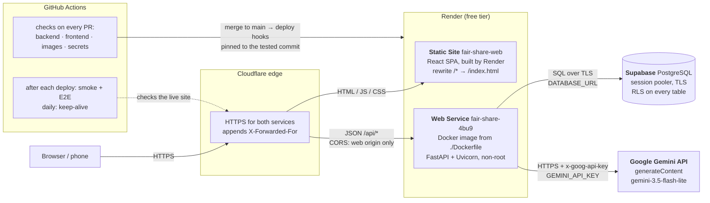
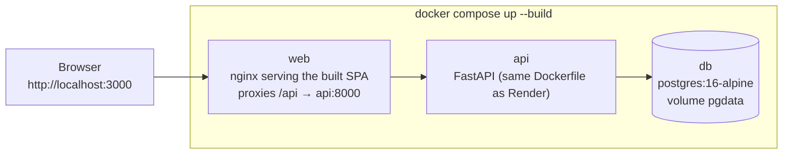
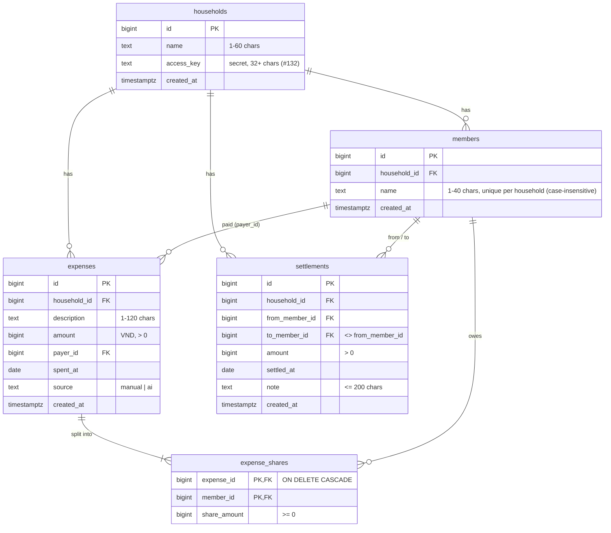
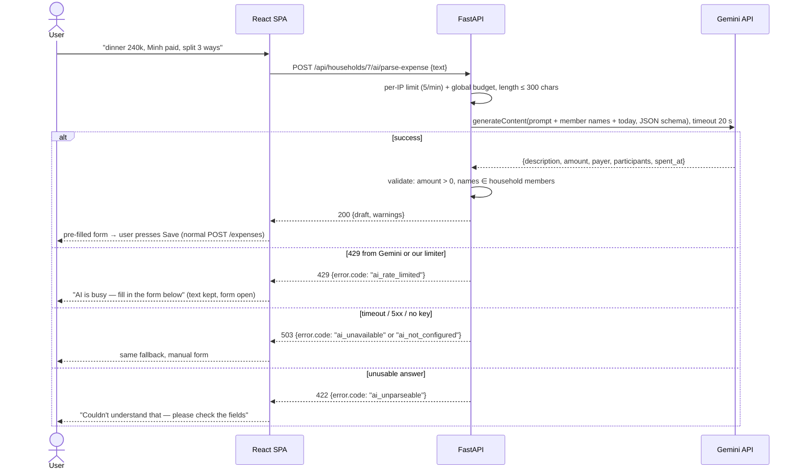
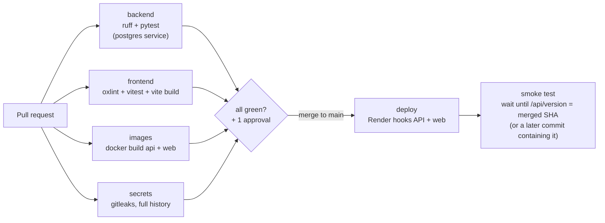

# Fair-Share — Architecture

This document is the source for report sections 1, 2, 3, 5, 6 and 7. **Rule: the diagrams here must
always match what is deployed.** A PR that changes the topology updates this file in the same PR.

> **Status legend.** This document describes the **target** for Session 20. Live today (20/10): the
> React SPA on a Render Static Site (`fair-share-web`), the API on Render (`fair-share-4bu9`) with
> Supabase PostgreSQL, CI + deploy hooks, and Compose with `web` (nginx + SPA) + `api` + `db`.
> Items marked *(W8)* arrive with that milestone; the PR that ships one removes its marker.

## 1. Deployed topology (production)

Checked against the live services on 22/10/2026; the exported diagrams for the report and how each
part was checked are in [`docs/diagrams/`](diagrams/README.md).



| Component | Runs on | Talks to | How it is configured |
|---|---|---|---|
| **React SPA** | Render Static Site (CDN, HTTPS, never sleeps) | API over HTTPS (`fetch`) | `VITE_API_BASE_URL` at build time (public, not a secret); rewrite rule `/* → /index.html` so React Router deep links work |
| **FastAPI API** | Render Web Service, Docker, free instance (sleeps after ~15 min idle) | Supabase, Gemini | `DATABASE_URL`, `GEMINI_API_KEY`, `GEMINI_MODEL`, `ALLOWED_ORIGINS`, `APP_ENV` |
| **PostgreSQL** | Supabase free project (pauses after a period of inactivity; a paused project must be **resumed from the dashboard** — a query does not wake it) | — | Connection string from the Supabase dashboard, **session pooler** (IPv4, `sslmode=require`) |
| **Gemini API** | Google AI Studio free tier | — | Key created in AI Studio, no billing account |
| **CI/CD** | GitHub Actions | Render deploy hooks | `RENDER_DEPLOY_HOOK_API`, `RENDER_DEPLOY_HOOK_WEB` (Actions secrets). **Render auto-deploy is Off** on both services, so only a green pipeline deploys |

**Why the browser never talks to Gemini or the database:** the key and the connection string exist only
on the API server. The SPA is static files; anything shipped to the browser is public.

## 2. Local topology (Docker Compose) — and why it differs



| Concern | Local (Compose) | Cloud |
|---|---|---|
| Database | Container `db`, data in the `pgdata` volume, seed data loaded | Supabase managed PostgreSQL, persistent; **we keep our own `pg_dump` exports** (T-27) rather than rely on free-tier backups |
| SPA → API | Same origin: nginx proxies `/api` to `api:8000`, so no CORS | Two origins: SPA calls the API URL; API allows only the SPA origin |
| AI key | Optional in `.env`; without it the AI box shows "not configured" and manual entry works | Render environment variable |
| TLS | None (localhost) | Render terminates HTTPS; Supabase requires TLS |

The **API image is identical** in both: the Dockerfile at the repository root is what Render builds.

**Start-up order** (`depends_on` with `condition: service_healthy`): `db` passes `pg_isready` → `api`
starts and passes its `/health` check → `web` starts. The first page load after `docker compose up`
therefore never meets a booting API. Published ports: `3000` → `web:8080` (the app), `8000` → `api:8000`
(`/docs` and `/health/db` while developing). `db` publishes no port: only `api` talks to it.

**The web image** (`frontend/Dockerfile`) is used **only by Compose**; Render's Static Site runs
`npm run build` itself and serves `dist/` from its CDN.

| Choice | Why |
|---|---|
| Two stages: `node:22-alpine` builds, `nginx-unprivileged:1.29-alpine` serves | The final image holds only nginx and `dist/`: no Node, `node_modules` or source |
| `package*.json` copied and `npm ci` run before the source | Dependency layer stays cached while only code changes |
| nginx runs as uid 101 and listens on **8080** | Same no-root rule as the API image; a non-root process cannot bind ports below 1024 |
| `try_files $uri /index.html` | React Router deep links (`/households/7`) survive a reload |
| `/api/` proxied unchanged to `${API_UPSTREAM}` (default `http://api:8000`), looked up per request through the container's DNS (`NGINX_LOCAL_RESOLVERS`) | Works on Docker and Podman; nginx starts even if `api` is not up yet (that request gets a 502) |
| `X-Forwarded-For` set on proxied requests | The API sees the real client IP for the AI per-IP limit |
| `/assets/*` cached for a year (`immutable`), `index.html` sent `no-cache` | Vite hashes asset names, so a new deploy is picked up on the next load |

## 3. Repository layout (target)

```
Fair-Share/
├── app/                      # FastAPI backend (one Docker image)
│   ├── main.py               # app factory, CORS, routers, /health, /health/db
│   ├── config.py             # Settings read from environment variables
│   ├── db.py                 # psycopg connection pool
│   ├── migrate.py            # applies db/migrations/*.sql once, at start-up
│   ├── schemas.py            # Pydantic request/response models
│   ├── routers/              # households, members, expenses, settlements, balances, ai
│   └── services/             # splitting.py, balances.py, gemini.py (unit-tested, no database)
├── db/
│   ├── migrations/001_init.sql, 002_household_keys.sql
│   └── seed.sql              # demo household for local Compose only
├── frontend/                 # React + TypeScript + Vite SPA
│   ├── src/                  # pages/, components/, api/
│   ├── Dockerfile            # node build stage → nginx runtime stage (local Compose)
│   └── nginx.conf            # template: SPA fallback, /api proxy, asset caching
├── tests/                    # pytest: unit + API tests against a real PostgreSQL
├── .github/workflows/ci-cd.yml
├── compose.yml
├── Dockerfile                # API image
└── docs/
```

## 4. Data model



The schema is [`db/migrations/001_init.sql`](../db/migrations/001_init.sql). A payer and both parties of a
settlement must be members of the **same household** (composite foreign keys on
`(household_id, member_id)`), so even a buggy request cannot mix households.

**Design decisions**

* **Money is an integer number of đồng (`bigint`)**, never a float. No rounding errors, easy to test.
* **Equal split rule:** `base = amount // n`, the remaining `amount % n` đồng go one each to the
  participants with the lowest member id. Shares therefore always sum to the amount exactly.
* **Balances are computed, not stored:**
  `net(m) = Σ paid by m − Σ shares of m + Σ settlements sent by m − Σ settlements received by m`.
  Positive = the household owes m. The sum of all nets is 0 (asserted in tests).
* **Suggested settlements:** greedy matching of the largest debtor with the largest creditor; at most
  *n − 1* transfers. Pure function in `services/balances.py`, unit-tested.
* **Migrations:** numbered SQL files applied once each at API start-up and recorded in a
  `schema_migrations` table, so a fresh Supabase project and a fresh Compose volume reach the same schema
  with no manual step. Each file runs **in its own transaction** (a failure rolls back completely) while
  holding a PostgreSQL **advisory lock**, so two instances starting together cannot apply it twice.
  Schema changes are new files, never edits to applied ones. CI applies them to a fresh database
  (`python -m app.migrate`), and the tests check a repeated run, a failing file and two concurrent runs.
  If the database is unreachable at start-up, the API logs it and starts anyway (so `/health` stays
  green); the next start applies the migrations, and until then `/health/db` answers
  `503 database_not_initialized` or `database_unavailable`. A broken migration (an SQL error) stops the API
  from starting, so the deploy fails instead of half-applying a schema.
* **Deleting:** a member that an expense, a share or a settlement points to cannot be deleted (foreign
  key without `ON DELETE`, the API answers 409). Deleting a household is two statements in one
  transaction: its expenses (with their shares), then the household (members and settlements cascade).
  A single `DELETE` is not enough, because PostgreSQL checks the members' keys before the nested
  expenses → shares cascade has run.
* **Supabase's REST API is closed:** every table has Row Level Security enabled with no policies, so the
  public Data API key can read nothing. The API connects as the tables' owner, which RLS does not apply to.
* **Demo data:** [`db/seed.sql`](../db/seed.sql) adds one household with three members, five
  expenses over last month and this month (dated from today, never in the future) and one
  settlement, only when `SEED_DEMO_DATA=true` (Compose) and only into an empty database. Never set
  on Render.
* **Surviving a restart or a pause:** all state lives in PostgreSQL; the API is stateless and reconnects
  through the pool. `/health/db` runs one query and returns a **safe** message on failure (details only
  in the server log). Before a demo: open the Supabase dashboard, *Resume* the project if it is paused,
  then hit `/health/db`. A daily scheduled workflow queries the database so it is not paused for
  inactivity (T-26), and a restart/restore drill (T-27) proves the data survives: [`PERSISTENCE_DRILL.md`](PERSISTENCE_DRILL.md), with `scripts/db-backup.sh` and `scripts/db-restore.sh` for our own `pg_dump` backups.
* **While the database is down** the API backs off instead of retrying on every request: the pool
  stops its own retries after 60 s, and after a failed attempt requests get the 503 at once for 20 s
  (`DatabaseCooldown` in `app/db.py`). Added after the outages of 22–23/10, when our retries got the
  project blocked by the pooler: [OUTAGES.md](OUTAGES.md).

## 5. API (JSON, prefix `/api`)

| Method & path | Purpose | Notes |
|---|---|---|
| `GET /health` | Liveness for Render and the pipeline | Never touches the DB |
| `GET /health/db` | Readiness: one query against PostgreSQL | 503 with a safe message on failure |
| `GET /api/version` | App name, version, environment, `commit` (Render's `RENDER_GIT_COMMIT`) | The smoke test waits until `commit` equals the merged SHA |
| `POST /api/households` | Create a household (no `GET`: no list of every household, #132; the SPA remembers the ones a browser created or opened) | `201` on create, with the household's `key`: the only answer that contains it |
| `GET/PATCH/DELETE /api/households/{id}` | One household | `404 household_not_found`; delete removes everything in it, `204` |
| `GET/POST /api/households/{id}/members` | Members of a household, oldest first | `409 member_name_taken` (case-insensitive), `409 too_many_members` (50, the most one expense can be split between) |
| `PATCH/DELETE /api/members/{id}` | Rename / remove member | `404 member_not_found`; `409 member_in_use` if in an expense or a settlement |
| `GET/POST /api/households/{id}/expenses` | List (newest first by `spent_at`) / create | Body below; `422 split_mismatch`, `unknown_member`, `duplicate_member` |
| `GET/PUT/DELETE /api/expenses/{id}` | One expense with its shares | `PUT` replaces it, same body as create; `404 expense_not_found` |
| `GET/POST /api/households/{id}/settlements` | List (newest first) / record a payment | Body `{from_member_id, to_member_id, amount, settled_at, note?}`; `422 same_member`, `unknown_member` |
| `DELETE /api/settlements/{id}` | Undo a mistaken settlement (there is no edit) | `204`; `404 settlement_not_found` |
| `GET /api/households/{id}/balances` | Per-member paid / owed / net + suggested transfers | Computed on each request; response below |
| `POST /api/households/{id}/ai/parse-expense` | **AI quick add** — `{text}` (1–300 characters) in, a draft out; saves nothing | Response and error codes in §6 |

**Household key** (#132). Every route below `POST /api/households` belongs to one household, and the
request must send that household's key in the `X-Household-Key` header (`app/access.py`, a dependency on
each router; the AI route checks it before it spends any of the AI budget). A missing or wrong key gets
the same `404` as an id that does not exist (`household_not_found`, or `member_not_found` etc. for an
item), so ids cannot be probed. The key is 32 random hex characters made by the database
(`002_household_keys.sql`) and compared in constant time. The SPA learns it from the create answer or
from an invite link `/households/{id}#k={key}`: after `#`, so it never reaches a server log or a
`Referer` header; it is kept in `localStorage` and removed from the address bar.

Errors use one shape: `{"error": {"code": "member_in_use", "message": "…human readable…"}}`.
FastAPI's interactive docs at `/docs` are the living API reference.

* `code` is stable, for the page to branch on; `message` is safe to show. Internal details (SQL, hosts,
  stack traces) only go to the server log.
* A `422 validation_error` adds `details`: one `{"loc", "type", "msg"}` per bad field, e.g.
  `"loc": ["body", "name"]`, so a form can highlight it. It never echoes the rejected input.
* Errors the framework raises use the same shape: `404 not_found` (unknown route),
  `405 method_not_allowed`, `413 payload_too_large`, `500 internal_error`, `503 database_unavailable`.

**Input limits** (T-25). Every limit is checked before the database is touched, so bad input is a
`422` naming the field, never a `500`:

| Input | Rule |
|---|---|
| Household name · member name · expense description · settlement note · AI text | 1–60 · 1–40 · 1–120 · 0–200 · 1–300 characters, after trimming |
| Any text | Stored in one Unicode form (NFC), so "Tiến" typed with combining accents is the same member as "Tiến"; control characters (NUL, line breaks, …) and broken UTF-8 are refused. The AI sentence is the exception for line breaks and tabs: they become spaces, so a message pasted over several lines still works |
| Amounts, member ids in a body | JSON numbers only: `true`, `"1000"` and `1000.5` are refused, not converted |
| Amount | 1 to 1 000 000 000 000 đồng (custom shares may be 0) |
| `spent_at`, `settled_at` | 2000-01-01 to 2099-12-31 |
| Participants in one split | 1 to 50 |
| Request body | At most 64 KB, otherwise `413 payload_too_large` (`app/limits.py`) |

**Expense body** (`POST` and `PUT`). Amounts are whole đồng; `spent_at` is the day it was spent.

```jsonc
{
  "description": "Lẩu thứ sáu",          // 1-120 characters
  "amount": 100000,                      // > 0
  "payer_id": 2,                         // a member of this household
  "spent_at": "2026-10-23",
  "source": "manual",                    // optional; "ai" when saved from a Quick add draft
  "split": {"type": "equal", "member_ids": [1, 2, 3]}
  // or:   {"type": "custom", "shares": [{"member_id": 1, "amount": 60000},
  //                                     {"member_id": 3, "amount": 40000}]}   // must sum to amount
}
```

The response adds `id`, `household_id`, `created_at`, the stored `shares` (in member id order, always
summing to `amount`; an equal split of 100 000 between members 1, 2, 3 is 33 334 / 33 333 / 33 333) and
`split_type` (`"equal"` when the shares are exactly the equal split), so an edit form can be pre-filled.

**Balances response** (Minh paid a 300 000 dinner for three, then Tiến paid him back 100 000):

```jsonc
{
  "balances": [                          // every member, in member id order; nets sum to 0
    {"member_id": 1, "name": "Tiến", "paid": 0, "owed": 100000, "sent": 100000, "received": 0, "net": 0},
    {"member_id": 2, "name": "Minh", "paid": 300000, "owed": 100000, "sent": 0, "received": 100000, "net": 100000},
    {"member_id": 3, "name": "Duy Anh", "paid": 0, "owed": 100000, "sent": 0, "received": 0, "net": -100000}
  ],
  "suggested": [                         // pay these and every net is 0; at most n - 1 of them
    {"from_member_id": 3, "to_member_id": 2, "amount": 100000}
  ]
}
```

"Record this payment" on the dashboard is a normal `POST /settlements` with a suggested transfer.

## 6. AI integration — Quick add



**Response** (`200`). `draft` has the same fields as the expense body in §5, so after the user has checked
it the page can send it unchanged to `POST /expenses`. Names are matched to members ignoring case and
accents (`"tien"` → Tiến), and a single word matches when only one member has it (`"Duy"` → Duy Anh).

```jsonc
{
  "draft": {
    "description": "Taxi",
    "amount": 80000,                     // null when the sentence had no amount
    "payer_id": null,                    // null when nobody, or nobody known, paid
    "spent_at": "2026-10-20",            // today in Vietnam (UTC+7) if the sentence had no date
    "source": "ai",
    "split": {"type": "equal", "member_ids": [1, 3]}   // everyone when nobody was named
  },
  "warnings": [                          // what the form should highlight; empty when all is clear
    {"code": "unknown_member", "name": "Hùng", "message": "\"Hùng\" is not a member of this household"}
  ]
}
```

| Warning `code` | When |
|---|---|
| `unknown_member` | A name in the sentence is not a member (or could be several); `name` says which |
| `no_payer` | The sentence does not say who paid |
| `no_amount` | The sentence has no amount |
| `participants_assumed` | Nobody was named, so the draft splits between everyone |

**Errors:** `404 household_not_found`, `409 no_members` (add members first), `422 validation_error`
(empty or over 300 characters), `422 ai_unparseable`, `422 too_many_participants` (over 50 people), `429 ai_rate_limited`, `503 ai_unavailable` (Gemini slow or down: retry may work), `503 ai_not_configured` (no key on this server: the page disables Quick add).
Every one of them leaves the manual form open with the text kept.

* **Where the call happens:** only in `app/services/gemini.py` on the server (Python's `urllib`,
  no extra dependency), through `generateContent` with a JSON schema for the answer.
* **Key security:** `GEMINI_API_KEY` is read from the environment. It is never logged, never returned,
  never sent to the browser, never needed by CI (tests mock the HTTP call).
* **Rate limits:** Gemini quotas apply **per project** (requests/min, tokens/min, requests/day) and differ
  by model — record the chosen model's current free numbers from AI Studio in the report. The API
  enforces two limits: per client IP (5/min) **and** a global budget set below the project quota
  (10/min, 200/day), in `app/services/rate_limit.py`. Only requests that reach Gemini count.
  **We do not auto-retry** on 429 or after a timeout — that burns quota and makes the user wait. A *fast*
  5xx (Gemini overloaded, under 3 s) is retried **once** after a short pause, and only if the global
  budget has room: the retry is counted there too, never in the visitor's own 5/min. The retry only
  gets what is left of the timeout (at least 1 s), so the user waits about `AI_TIMEOUT` at most.
* **Who is "one visitor":** each proxy in front of the API appends the address it saw to
  `X-Forwarded-For`, so the visitor is `FORWARDED_HOPS` entries from the end and anything further left
  (which a client can make up) is ignored. On Render it is **3** entries from the end: Cloudflare
  appends the visitor and two more proxies append theirs. This was read from the live logs, where
  Cloudflare's `CF-Connecting-IP` is entry -3 (`x-forwarded-for has 3 entries`, or 4 when the client
  sent its own header). Those two proxy entries change from request to request, which is why using
  the last one, and then the second-to-last, let every call through. Behind nginx in Compose it is 1. A request whose address cannot
  be read joins one shared bucket instead of getting a fresh limit, and an IPv6 visitor is counted
  per /64 (a phone may switch address inside it on every call). Each Quick add request logs the
  header *shape* (entry count, where Cloudflare's `CF-Connecting-IP` sits), never an address, so the
  setting can be checked from the Render logs.
* **Latency:** every call logs how long Gemini took (`gemini: answered in … ms`). On 21/10 the live
  server measured 7.2–8.8 s per answer with `gemini-3.5-flash-lite`, and most failures were the old
  10 s timeout cutting off an answer still on its way, so `AI_TIMEOUT` defaults to 20 s. The page
  should show that Quick add is working for that long, with the manual form still usable.
* **Prompt-injection stance:** the model output is treated as untrusted data — it is schema-validated,
  names are matched against real members, and nothing is written to the database without the user
  pressing *Save*.
* **Model:** `GEMINI_MODEL` environment variable (default `gemini-3.5-flash-lite`, a stable Flash-Lite model), so a deprecated
  model is a configuration change, not a code change.

## 7. Platform selection and declared fallbacks (zero credit card)

| Need | Chosen | Chosen over | What the choice costs us | Declared fallback |
|---|---|---|---|---|
| API hosting | **Render Web Service** (Docker) | Railway, Fly.io (need a card), Vercel (not for long-running Docker) | Sleeps after ~15 min idle → ~50 s cold start; 750 free hours/month | Koyeb / Northflank free tier (verify no card before switching) |
| SPA hosting | **Render Static Site** | GitHub Pages, Netlify | One more service to configure; but same dashboard and deploy-hook model | GitHub Pages |
| Database | **Supabase** PostgreSQL | Neon, Render PostgreSQL (free DB expires after 30 days) | Pauses after 7 days idle; direct host is IPv6-only → must use the pooler | Neon |
| AI | **Google Gemini** | Groq, OpenRouter, Hugging Face | Free quota per minute/day; data sent to Google (we send only the sentence, the household's member names and today's date) | Groq (OpenAI-compatible API) |
| CI/CD | **GitHub Actions** | GitLab CI, Jenkins | Minutes are free for public repositories | — |

## 8. Configuration and secrets

| Name | Secret? | Local (Compose) | CI (GitHub Actions) | Production (Render) |
|---|---|---|---|---|
| `DB_PASSWORD` | yes | `.env` (git-ignored) | — | — |
| `DATABASE_URL` | **yes** | built in `compose.yml` from `DB_PASSWORD` | throw-away URL to the job's own `postgres` service container | API service env var (Supabase pooler URL) |
| `GEMINI_API_KEY` | **yes** | `.env`, optional | **never** — tests mock Gemini | API service env var |
| `GEMINI_MODEL` | no | `.env.example` default | — | API service env var |
| `AI_TIMEOUT` | no | default `20` (seconds, must be > 0) | — | not set (default) |
| `FORWARDED_HOPS` | no | default `1` (nginx) | — | not set: `3` because Render sets `RENDER=true` |
| `ALLOWED_ORIGINS` | no | not needed (same origin) | — | `https://<web>.onrender.com` |
| `APP_ENV` | no | `development` | `test` | `production` |
| `SEED_DEMO_DATA` | no | `true` (in `compose.yml`) | — | **not set** |
| `VITE_API_BASE_URL` | no (public) | empty (same origin) | empty | Static site env var, build time |
| `RENDER_DEPLOY_HOOK_API` / `_WEB` | **yes** | — | Actions secrets | — |

Household keys (#132) are not configuration: they are data, one per household in the database, sent to
the browser that creates the household and never written to the server log. Only the local seed logs
the demo households' invite links (`SEED_DEMO_DATA`, never set on Render).

**If a key leaks** (written into the report as our incident runbook):
1. Revoke it at the provider immediately (AI Studio → delete key; Supabase → reset database password;
   Render → regenerate deploy hook).
2. Create a new value and update it **only** in Render / GitHub secrets; redeploy.
3. Find how it leaked (gitleaks on the full history, Actions logs, screenshots).
4. If it reached Git history: rewrite history with `git filter-repo`, force-push with the team's agreement,
   and treat the old value as compromised forever — rewriting does not un-leak it.
5. Open an issue describing the incident and the prevention added.

Preventive controls in place: `.env` git-ignored, `.env.example` with no real values, deploy hooks
only in Actions secrets, screenshots checked before they go into the report. Since T-29:
a gitleaks job in CI and GitHub secret scanning + push protection ([audit record](SECRET_AUDIT.md)).

## 9. CI/CD pipeline



| Job | Prevents from reaching `main` |
|---|---|
| `backend` | Python lint errors, broken endpoints, wrong split/balance maths, migrations that fail on a fresh DB |
| `frontend` | TypeScript errors (`tsc -b` in the build), oxlint errors, failing component tests, a SPA that does not build |
| `images` | A Dockerfile that no longer builds (what Render would fail on after merge), a container that crashes on start, or a `compose.yml` whose stack does not come up with the web app reaching the API and the API reaching PostgreSQL |
| `secrets` | A committed key or connection string, anywhere in the history (gitleaks, exceptions in `.gitleaks.toml`) |
| `deploy` | Runs only on `push` to `main` after all checks; PRs never deploy. The hook is pinned to the tested commit (`ref=`) and refused if it belongs to another Render service |
| `smoke` | A deploy hook only *queues* a deploy. This job proves the live API runs the exact merged commit, and that the web app serves the build of that commit (its `<meta name="commit">`, stamped from Render's `RENDER_GIT_COMMIT`, #153) — otherwise the run goes red |
| `E2E smoke (live)` | Separate workflow (`e2e.yml`), after every green CI/CD run on `main` and on demand: Playwright walks the main flow on the live site on a 360 px phone (create a household, members, an expense, Đã trả / Hoàn tác, settled). Catches what unit tests cannot: the deployed SPA, the API and Supabase working together. It writes a test household to the real database and always deletes it; it never calls Gemini. Not a required check: it runs after the merge, on the deployed app |

Branch protection on `main`: PR required, 1 approving review, required checks
`backend`, `frontend`, `images`, `secrets`, enforced for administrators.

> **Renaming a required check safely:** when the old Lab 4 `check` job was replaced by the three jobs
> above (T-13, #61), the required checks were switched on the PR before merging. Do the same for any
> future rename, or every PR waits forever for a check that no longer exists.
