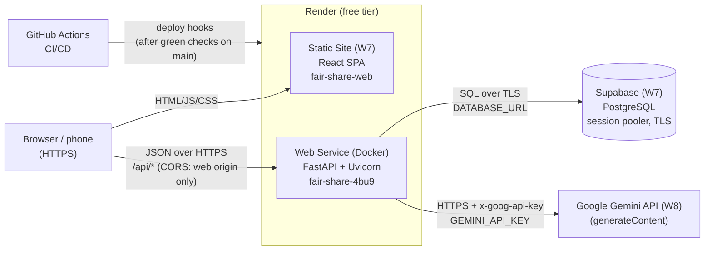
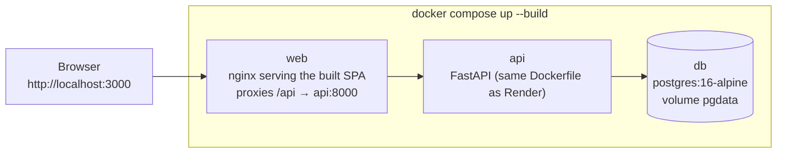
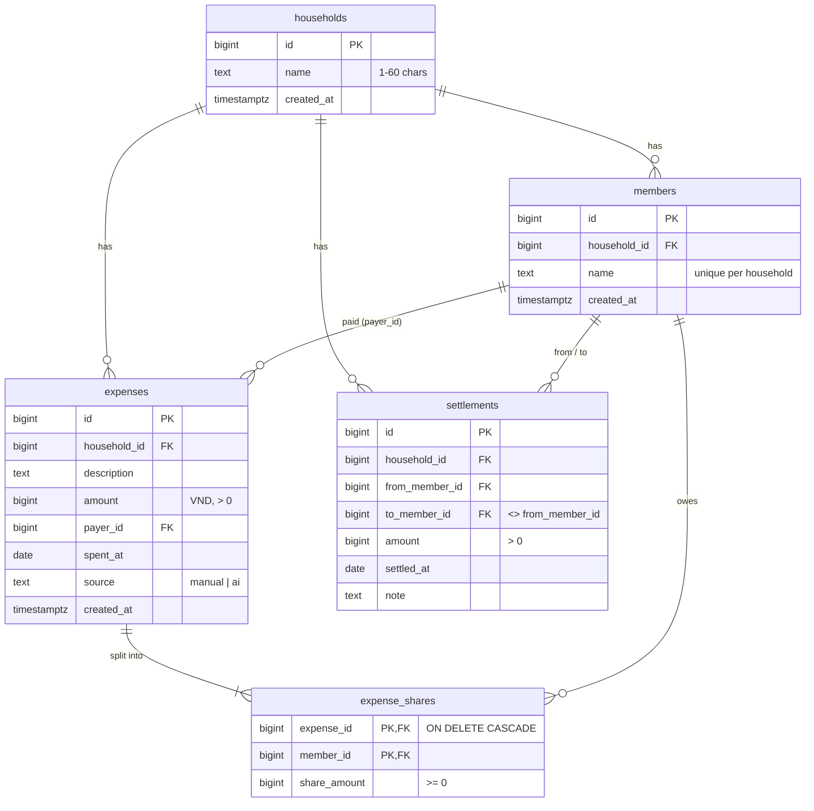
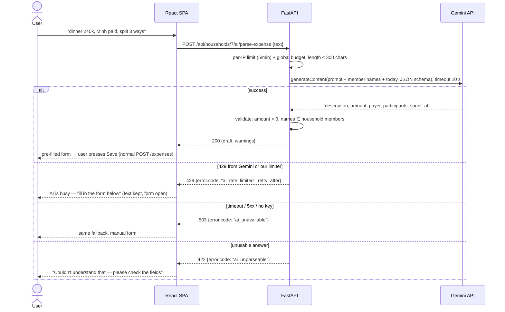
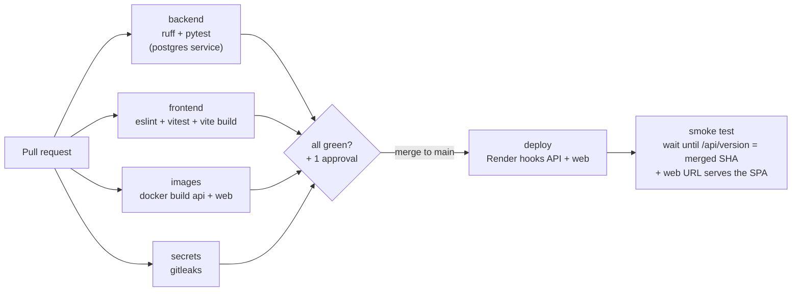

# Fair-Share — Architecture

This document is the source for report sections 1, 2, 3, 5, 6 and 7. **Rule: the diagrams here must
always match what is deployed.** A PR that changes the topology updates this file in the same PR.

> **Status legend.** This document describes the **target** for Session 20. Live today (16/10): the
> FastAPI starter on Render (`fair-share-4bu9`) with CI + deploy hook, and Compose with `web`
> (nginx + SPA) + `api` + `db`. Items marked *(W7)*, *(W8)* arrive with that milestone; the PR that ships one removes its marker.

## 1. Deployed topology (production)



| Component | Runs on | Talks to | How it is configured |
|---|---|---|---|
| **React SPA** | Render Static Site (CDN, HTTPS, never sleeps) | API over HTTPS (`fetch`) | `VITE_API_BASE_URL` at build time (public, not a secret); rewrite rule `/* → /index.html` so React Router deep links work |
| **FastAPI API** | Render Web Service, Docker, free instance (sleeps after ~15 min idle) | Supabase, Gemini | `DATABASE_URL`, `GEMINI_API_KEY`, `GEMINI_MODEL`, `ALLOWED_ORIGINS`, `APP_ENV` |
| **PostgreSQL** | Supabase free project (pauses after a period of inactivity; a paused project must be **resumed from the dashboard** — a query does not wake it) | — | Connection string from the Supabase dashboard, **session pooler** (IPv4, `sslmode=require`) |
| **Gemini API** | Google AI Studio free tier | — | Key created in AI Studio, no billing account |
| **CI/CD** | GitHub Actions | Render deploy hooks | `RENDER_DEPLOY_HOOK_API`, `RENDER_DEPLOY_HOOK_WEB` (Actions secrets). **Render auto-deploy is Off** on both services, so only a green pipeline deploys |

**Why the browser never talks to Gemini or the database:** the key and the connection string exist only
on the API server. The SPA is static files; anything shipped to the browser is public.

## 2. Local topology (Docker Compose) — and why it differs



| Concern | Local (Compose) | Cloud |
|---|---|---|
| Database | Container `db`, data in the `pgdata` volume, seed data loaded | Supabase managed PostgreSQL, persistent; **we keep our own `pg_dump` exports** (T-27) rather than rely on free-tier backups |
| SPA → API | Same origin: nginx proxies `/api` to `api:8000`, so no CORS | Two origins: SPA calls the API URL; API allows only the SPA origin |
| AI key | Optional in `.env`; without it the AI box shows "not configured" and manual entry works | Render environment variable |
| TLS | None (localhost) | Render terminates HTTPS; Supabase requires TLS |

The **API image is identical** in both: the Dockerfile at the repository root is what Render builds.

**Start-up order** (`depends_on` with `condition: service_healthy`): `db` passes `pg_isready` → `api`
starts and passes its `/health` check → `web` starts. The first page load after `docker compose up`
therefore never meets a booting API. Published ports: `3000` → `web:8080` (the app), `8000` → `api:8000`
(`/docs` and `/health/db` while developing). `db` publishes no port: only `api` talks to it.

**The web image** (`frontend/Dockerfile`) is used **only by Compose**; Render's Static Site runs
`npm run build` itself and serves `dist/` from its CDN.

| Choice | Why |
|---|---|
| Two stages: `node:22-alpine` builds, `nginx-unprivileged:1.29-alpine` serves | The final image holds only nginx and `dist/`: no Node, `node_modules` or source |
| `package*.json` copied and `npm ci` run before the source | Dependency layer stays cached while only code changes |
| nginx runs as uid 101 and listens on **8080** | Same no-root rule as the API image; a non-root process cannot bind ports below 1024 |
| `try_files $uri /index.html` | React Router deep links (`/households/7`) survive a reload |
| `/api/` proxied unchanged to `${API_UPSTREAM}` (default `http://api:8000`), looked up per request through the container's DNS (`NGINX_LOCAL_RESOLVERS`) | Works on Docker and Podman; nginx starts even if `api` is not up yet (that request gets a 502) |
| `X-Forwarded-For` set on proxied requests | The API sees the real client IP for the AI per-IP limit |
| `/assets/*` cached for a year (`immutable`), `index.html` sent `no-cache` | Vite hashes asset names, so a new deploy is picked up on the next load |

## 3. Repository layout (target)

```
Fair-Share/
├── app/                      # FastAPI backend (one Docker image)
│   ├── main.py               # app factory, CORS, routers, /health, /health/db
│   ├── config.py             # Settings read from environment variables
│   ├── db.py                 # psycopg connection pool
│   ├── migrate.py            # applies db/migrations/*.sql once, at start-up
│   ├── schemas.py            # Pydantic request/response models
│   ├── routers/              # households, members, expenses, settlements, balances, ai
│   └── services/             # splitting.py, balances.py, ai_parser.py (pure, unit-tested)
├── db/
│   ├── migrations/001_init.sql
│   └── seed.sql              # demo household for local Compose only
├── frontend/                 # React + TypeScript + Vite SPA
│   ├── src/                  # pages/, components/, api/
│   ├── Dockerfile            # node build stage → nginx runtime stage (local Compose)
│   └── nginx.conf            # template: SPA fallback, /api proxy, asset caching
├── tests/                    # pytest: unit + API tests against a real PostgreSQL
├── .github/workflows/ci-cd.yml
├── compose.yml
├── Dockerfile                # API image
└── docs/
```

## 4. Data model



**Design decisions**

* **Money is an integer number of đồng (`bigint`)**, never a float. No rounding errors, easy to test.
* **Equal split rule:** `base = amount // n`, the remaining `amount % n` đồng go one each to the
  participants with the lowest member id. Shares therefore always sum to the amount exactly.
* **Balances are computed, not stored:**
  `net(m) = Σ paid by m − Σ shares of m + Σ settlements sent by m − Σ settlements received by m`.
  Positive = the household owes m. The sum of all nets is 0 (asserted in tests).
* **Suggested settlements:** greedy matching of the largest debtor with the largest creditor; at most
  *n − 1* transfers. Pure function in `services/balances.py`, unit-tested.
* **Migrations:** numbered SQL files applied once each at API start-up and recorded in a
  `schema_migrations` table, so a fresh Supabase project and a fresh Compose volume reach the same schema
  with no manual step. Each file runs **in its own transaction** (a failure rolls back completely) while
  holding a PostgreSQL **advisory lock**, so two instances starting together cannot apply it twice.
  Schema changes are new files, never edits to applied ones. CI tests a fresh database and an upgrade
  from the previous migration.
* **Surviving a restart or a pause:** all state lives in PostgreSQL; the API is stateless and reconnects
  through the pool. `/health/db` runs one query and returns a **safe** message on failure (details only
  in the server log). Before a demo: open the Supabase dashboard, *Resume* the project if it is paused,
  then hit `/health/db`. A daily scheduled workflow queries the database so it is not paused for
  inactivity (T-26), and a restart/restore drill (T-27) proves the data survives.

## 5. API (JSON, prefix `/api`)

| Method & path | Purpose | Notes |
|---|---|---|
| `GET /health` | Liveness for Render and the pipeline | Never touches the DB |
| `GET /health/db` | Readiness: one query against PostgreSQL | 503 with a safe message on failure |
| `GET /api/version` | App name, version, environment, `commit` (Render's `RENDER_GIT_COMMIT`) | The smoke test waits until `commit` equals the merged SHA |
| `GET/POST /api/households` | List / create households | |
| `GET/PATCH/DELETE /api/households/{id}` | One household | Delete cascades |
| `GET/POST /api/households/{id}/members` | Members of a household | 409 on duplicate name |
| `PATCH/DELETE /api/members/{id}` | Rename / remove member | 409 if referenced by an expense |
| `GET/POST /api/households/{id}/expenses` | List (newest first) / create | Body: `split: {type: "equal" \| "custom", ...}` |
| `GET/PUT/DELETE /api/expenses/{id}` | One expense with its shares | |
| `GET/POST /api/households/{id}/settlements` | List / record a payment | |
| `DELETE /api/settlements/{id}` | Undo a mistaken settlement | |
| `GET /api/households/{id}/balances` | Per-member paid / owed / net + suggested transfers | |
| `POST /api/households/{id}/ai/parse-expense` | **AI quick add** — returns a draft, saves nothing | See §6 |

Errors use one shape: `{"error": {"code": "member_in_use", "message": "…human readable…"}}`.
FastAPI's interactive docs at `/docs` are the living API reference.

## 6. AI integration — Quick add



* **Where the call happens:** only in `app/services/ai_parser.py` on the server, using `httpx`.
* **Key security:** `GEMINI_API_KEY` is read from the environment. It is never logged, never returned,
  never sent to the browser, never needed by CI (tests mock the HTTP call).
* **Rate limits:** Gemini quotas apply **per project** (requests/min, tokens/min, requests/day) and differ
  by model — record the chosen model's current free numbers from AI Studio in the report. The API
  enforces two limits: per client IP (5/min) **and** a global budget set below the project quota
  (e.g. 10/min, 200/day). We **do not auto-retry** on 429 — retrying burns quota and makes the user wait.
* **Prompt-injection stance:** the model output is treated as untrusted data — it is schema-validated,
  names are matched against real members, and nothing is written to the database without the user
  pressing *Save*.
* **Model:** `GEMINI_MODEL` environment variable (default chosen in issue *AI client*), so a deprecated
  model is a configuration change, not a code change.

## 7. Platform selection and declared fallbacks (zero credit card)

| Need | Chosen | Chosen over | What the choice costs us | Declared fallback |
|---|---|---|---|---|
| API hosting | **Render Web Service** (Docker) | Railway, Fly.io (need a card), Vercel (not for long-running Docker) | Sleeps after ~15 min idle → ~50 s cold start; 750 free hours/month | Koyeb / Northflank free tier (verify no card before switching) |
| SPA hosting | **Render Static Site** | GitHub Pages, Netlify | One more service to configure; but same dashboard and deploy-hook model | GitHub Pages |
| Database | **Supabase** PostgreSQL | Neon, Render PostgreSQL (free DB expires after 30 days) | Pauses after 7 days idle; direct host is IPv6-only → must use the pooler | Neon |
| AI | **Google Gemini** | Groq, OpenRouter, Hugging Face | Free quota per minute/day; data sent to Google (we send only the sentence and member first names) | Groq (OpenAI-compatible API) |
| CI/CD | **GitHub Actions** | GitLab CI, Jenkins | Minutes are free for public repositories | — |

## 8. Configuration and secrets

| Name | Secret? | Local (Compose) | CI (GitHub Actions) | Production (Render) |
|---|---|---|---|---|
| `DB_PASSWORD` | yes | `.env` (git-ignored) | — | — |
| `DATABASE_URL` | **yes** | built in `compose.yml` from `DB_PASSWORD` | throw-away URL to the job's own `postgres` service container | API service env var (Supabase pooler URL) |
| `GEMINI_API_KEY` | **yes** | `.env`, optional | **never** — tests mock Gemini | API service env var |
| `GEMINI_MODEL` | no | `.env.example` default | — | API service env var |
| `ALLOWED_ORIGINS` | no | not needed (same origin) | — | `https://<web>.onrender.com` |
| `APP_ENV` | no | `development` | `test` | `production` |
| `VITE_API_BASE_URL` | no (public) | empty (same origin) | empty | Static site env var, build time |
| `RENDER_DEPLOY_HOOK_API` / `_WEB` | **yes** | — | Actions secrets | — |

**If a key leaks** (written into the report as our incident runbook):
1. Revoke it at the provider immediately (AI Studio → delete key; Supabase → reset database password;
   Render → regenerate deploy hook).
2. Create a new value and update it **only** in Render / GitHub secrets; redeploy.
3. Find how it leaked (gitleaks on the full history, Actions logs, screenshots).
4. If it reached Git history: rewrite history with `git filter-repo`, force-push with the team's agreement,
   and treat the old value as compromised forever — rewriting does not un-leak it.
5. Open an issue describing the incident and the prevention added.

Preventive controls: `.env` git-ignored, `.env.example` with empty values, gitleaks job in CI, GitHub
secret scanning + push protection enabled, screenshots checked before they go into the report.

## 9. CI/CD pipeline (target)



| Job | Prevents from reaching `main` |
|---|---|
| `backend` | Python lint errors, broken endpoints, wrong split/balance maths, migrations that fail on a fresh DB |
| `frontend` | TypeScript/ESLint errors, failing component tests, a SPA that does not build |
| `images` | A Dockerfile that no longer builds (what Render would fail on after merge), a container that crashes on start, or a `compose.yml` whose stack does not come up with the web app reaching the API and the API reaching PostgreSQL |
| `secrets` | A committed key or connection string |
| `deploy` | Runs only on `push` to `main` after all checks; PRs never deploy |
| `smoke` | A deploy hook only *queues* a deploy. This job proves the live API runs the exact merged commit and the web app loads — otherwise the run goes red |

Branch protection on `main`: PR required, 1 approving review, required checks
`backend`, `frontend`, `images`, `secrets`, enforced for administrators.

> **Renaming the required check safely (T-13):** today `check` is required. The PR that replaces it
> runs the new jobs; once they are green on that PR, switch the required checks to the new names and
> remove `check` in the same sitting, then merge. Otherwise every PR waits forever for a `check` that
> no longer exists.
