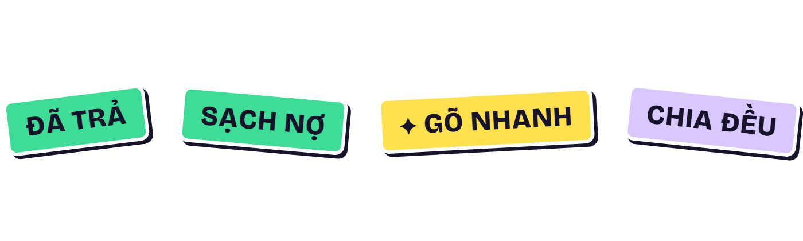
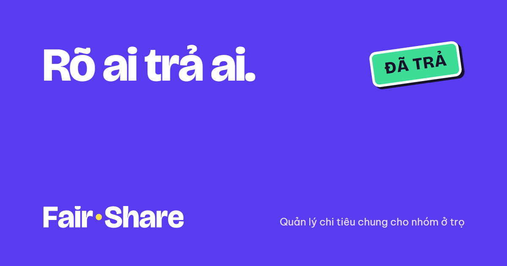

# Fair-Share — Brand

One identity for the web app, the link preview, the README, the slides and the report. The product UI
rules live in [DESIGN.md](DESIGN.md); this file covers the name, the mark and how they are used. Files are
in [`docs/brand/`](brand/). Decided 21/10/2026 (T-44).

## 1. Core

| | |
|---|---|
| **Tagline** | **Rõ ai trả ai.** |
| **Descriptor** | Ứng dụng quản lý chi tiêu chung cho nhóm ở trọ. |
| **Promise** | Ghi khoản chi, rõ phần mình, dễ chốt tiền. |
| **Personality** | Rõ ràng · thân thiện · vui vừa đủ: playful in the stickers and when the house is settled, serious about every number |
| **What it never does** | It does not move or hold money. *Đã trả* only records a payment made outside the app. |

Lines we considered and dropped: *"Sổ chung của nhà trọ"* (reads like a debt ledger), *"khỏi ai quên ai"*
(ambiguous), *"rõ trong 10 giây"* (a speed claim we have not measured), *"Sạch nợ, nhà trọ bình yên"*
(kept as the in-app success line, too small for a promise).

## 2. Logo

| Wordmark (light) | Wordmark (on taro) | App icon |
|---|---|---|
|  | white letters, shown in the header image above |  |

* **Wordmark:** *Fair·Share* in Bricolage Grotesque 800, tracking −2%, converted to outlines. The middle
  dot is a yellow circle drawn in SVG, never the "·" character of a font.
* **The yellow dot is a coin** sitting between *Fair* and *Share*: the shared money in the middle, split
  fairly. It stays a plain circle at every size; the story carries the meaning, not extra detail.
* **On light backgrounds** the dot has a thin ink outline; **on taro** it has none and the letters are white
  (`wordmark-on-taro.svg`).
* **App icon:** a white *F* and the yellow dot on a taro square (64 grid, corner radius 14, dot r 5 at
  47, 45). The same drawing is used from 16 px to 512 px.

**Rules**

1. Clear space around the wordmark and icon: at least the diameter of the dot.
2. Smallest sizes: wordmark 120 px wide, icon 16 px.
3. Letters are ink or white only. Do not recolour, stretch, rotate or add shadows or outlines.
4. The dot is always a yellow circle. Do not replace it with "·", an emoji or a coin drawing.
5. Pairings: wordmark ink on white or lilac, white on taro or ink. Never yellow text on white, never pink
   text on taro.

Considered and dropped: a sticker cut into three wedges (reads as a pie chart and as "three people"), an
"=" in a sticker (looks like a calculator key), a circle split into two halves (the gap disappears at
16 px and it reads as a menu icon).

## 3. Colour

The same values as the UI tokens ([DESIGN.md §3](DESIGN.md#3-tokens)).

| Name | Hex | Role |
|---|---|---|
| Taro | `#5A3CF0` | the brand colour; drenched covers, the verdict block in the app |
| Ink | `#17132B` | text, outlines, sticker shadows |
| Lilac | `#F3F0FC` | light backgrounds |
| Yellow | `#FFE14D` | **attention**: the coin in the logo, Gõ nhanh (AI), the focus ring |
| Mint | `#3DDC97` | *được nhận*, the ĐÃ TRẢ and SẠCH NỢ stickers |
| Pink | `#FF5C8A` | *cần trả* |

On any surface one colour leads (about 60%), one supports, and yellow is only a spot (about 5%). Mint and
pink keep their money meaning and are not used as decoration.

## 4. Type

| Face | Use |
|---|---|
| **Bricolage Grotesque 800** | the wordmark, headings, large numbers, stickers; tracking −2% to −3.5% |
| **Be Vietnam Pro 400 / 500 / 700** | everything else; designed for Vietnamese diacritics |

Both are open-source (SIL Open Font License).

## 5. Stickers

Four, no more: **ĐÃ TRẢ** and **SẠCH NỢ** appear in the app; **✦ GÕ NHANH** and **CHIA ĐỀU** are for slides
and the demo. Stickers are the only things that are rotated or get the hard shadow.

## 6. Voice

| Do | Don't |
|---|---|
| State amount and people neutrally: *"Bạn cần trả Minh 120.000đ"* | Label or rank late payers: *"Hùng vẫn chưa trả"* |
| Give the next step: *"Chuyển cho Minh rồi bấm Đã trả"* | Use collector words: *con nợ, truy thu, quá hạn* |
| Remind the group, not a person: *"Cuối tháng rồi, cả nhà vào chốt sổ nha"* | Pressure: *"Trả ngay kẻo muộn"* |
| Celebrate the end: *"Cả nhà sạch nợ."* | Sound like a bank or a wallet: *thanh toán an toàn, giao dịch* |
| Say what the AI does: *"Gõ nhanh dùng Gemini, bạn kiểm tra lại trước khi lưu"* | Promise what we have not measured: *xong trong 10 giây, an toàn tuyệt đối* |

Link-preview metadata (the OG image, the page title and description) never includes member names or
balances. The reminder message is different on purpose: the user copies it for the household's own chat,
so it lists who pays whom and how much.

## 7. Files

| File | Size | Used in |
|---|---|---|
| [`wordmark.svg`](brand/wordmark.svg) · [`wordmark-on-taro.svg`](brand/wordmark-on-taro.svg) | vector | app header, README, slides |
| [`icon.svg`](brand/icon.svg) · `icon-16/32/180/192/512.png` | vector · PNG | favicon, home-screen icon (wired into the app in T-42) |
| [`og-image.png`](brand/og-image.png) | 1200 × 630 | link preview in Zalo / Messenger; essentials inside the central 1000 × 500 |
| [`readme-header.png`](brand/readme-header.png) | 1280 × 320 | top of the README |
| [`slide-cover.png`](brand/slide-cover.png) · [`slide-content.png`](brand/slide-content.png) | 1920 × 1080 | presentation: cover, and the content layout (lilac, ink text ≥ 28 px, one taro block per slide) |
| [`report-cover.png`](brand/report-cover.png) | A4 at 150 dpi | report PDF cover (no stickers on the report) |
| [`stickers.png`](brand/stickers.png) | 1400 × 420, transparent | slides, demo |

