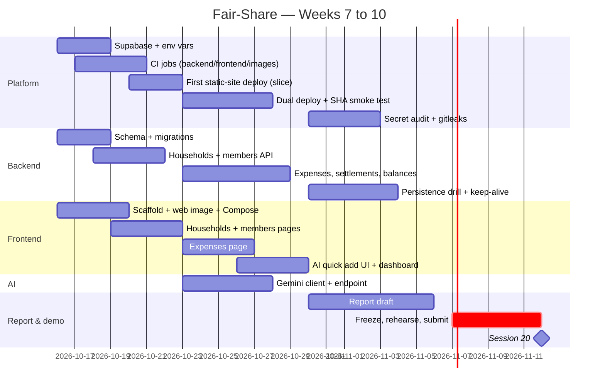

# Fair-Share — Roadmap and Work Plan

Today: Week 6 done (Lab 4). **Assessment: Session 20, Thursday 12 November 2026.**
Every task below is a GitHub issue (title starts with its ID, e.g. `T-07`) with an owner, a reviewer, a
milestone and labels; progress is tracked on the **Fair-Share Roadmap** project board.
This file is the plan; the board is the truth.

## 1. Team and roles

| Member | GitHub | Role | Owns (accountable for) |
|---|---|---|---|
| **Võ Việt Tiến** | [@NeitLN](https://github.com/NeitLN) | **Team leader · Project manager · Platform/DevOps lead · AI integration** | Roadmap and board, CI/CD, Render, Supabase, secrets, Gemini client, report editor, demo driver |
| **Hoàng Minh** | [@Jayson135724](https://github.com/Jayson135724) | **Backend & database lead** | Schema and migrations, REST API, split/balance logic, backend tests, persistence drill, architecture diagram |
| **Duy Anh** | [@anh7032](https://github.com/anh7032) | **Frontend lead · QA** | React SPA, AI quick-add UI and its failure states, web image and Compose, clean-clone rehearsal, slides |

Everyone reviews someone else's pull requests every week. **No PR is merged without another member's
approval**; after approval the author merges (see [CONTRIBUTING.md](../CONTRIBUTING.md)).

### RACI for the assessed platform pieces

R = does the work · A = accountable · C = consulted · I = informed

| Piece | Việt Tiến | Hoàng Minh | Duy Anh |
|---|---|---|---|
| Dockerfile (API) | A/R | C | I |
| Dockerfile (web) + nginx | C | I | A/R |
| Compose stack | C | R | A/R |
| CI/CD pipeline | A/R | C | C |
| Render (API + static site) | A/R | I | C |
| Supabase database | A | R | I |
| Schema, migrations, API | C | A/R | C |
| AI feature (server) | A/R | C | C |
| AI feature (UI + failure UX) | C | I | A/R |
| Secret audit | A/R | R | R |
| Report | A/R (editor) | R | R |
| Demo | A/R (driver) | R | R |

## 2. Timeline and milestones

| Milestone (GitHub) | Dates | Brief requirement | Exit criteria |
|---|---|---|---|
| **W7 · Foundation & cloud database** | Fri 16/10 → Thu 22/10 | Managed cloud DB attached by one env var | **Vertical slice live:** create a household and its members in the React app → API → Supabase, over HTTPS. Compose runs `db` + `api` + `web` from a clean clone (checked on a teammate's machine). CI has `backend` (real PostgreSQL), `frontend`, `images` jobs |
| **W8 · Features & AI live** | Fri 23/10 → Thu 29/10 | AI feature working on the live URL, failure handled | Every MVP user story US-01…US-10 on the live URL, including the balances dashboard; each deploy verified by commit SHA |
| **W9 · Hardening, audit & report draft** | Fri 30/10 → Thu 05/11 | Secret audit, peer-review findings as issues, report draft with 8 sections | gitleaks green on the full history; persistence drill done; peer-review findings filed and mostly closed; full report draft |
| **W10 · Demo ready** | Fri 06/11 → Wed 11/11 | Rehearsed demo, submitted report | **Feature freeze Sat 07/11**; clean-clone rehearsal on a fresh machine; PDF submitted; timed rehearsal |
| **Session 20** | **Thu 12/11** | Assessment | Live demo, presentation, individual defense |

## 3. Weekly plan by member

**P0** = needed for a passing demo · **P1** = needed for a strong grade · **P2** = nice to have.

### Week 7 · Foundation & cloud database (16/10 → 22/10)

| ID | Task | Owner | Reviewer | Pri |
|---|---|---|---|---|
| T-01 | Project spec, architecture, roadmap, contributing guide, PR/issue templates | Việt Tiến | Hoàng Minh | P0 |
| T-02 | Each member completes their own row in `TEAM.md` (name, student ID, GitHub) | **All** (own commit each) | Việt Tiến | P0 |
| T-03 | Close stale lab PRs #3 and #5, delete merged lab branches, set up labels, milestones and the project board | Việt Tiến | Duy Anh | P1 |
| T-04 | API Dockerfile hardening: Python 3.12 in Dockerfile and CI, pinned deps (incl. `psycopg`), non-root user, `.dockerignore` excludes `frontend/` | Việt Tiến | Hoàng Minh | P0 |
| T-05 | Create the Supabase project, set `DATABASE_URL` (session pooler, TLS) on Render, prove with `/health/db` on the live URL | Việt Tiến | Hoàng Minh | P0 |
| T-06 | Restructure backend: `config.py`, `db.py` pool, routers, error format, safe `/health/db` errors; remove starter `/items` | Hoàng Minh | Việt Tiến | P0 |
| T-07 | Schema v1 (`001_init.sql`), start-up migration runner (transaction per file + advisory lock), `seed.sql` | Hoàng Minh | Việt Tiến | P0 |
| T-08 | Households & members API + tests | Hoàng Minh | Duy Anh | P0 |
| T-09 | Scaffold `frontend/`: Vite + React + TS, React Router, ESLint, Vitest, typed API client | Duy Anh | Việt Tiến | P0 |
| T-10 | Web image: multi-stage `frontend/Dockerfile` (node build → nginx) + `nginx.conf` proxying `/api` | Duy Anh | Việt Tiến | P0 |
| T-11 | Compose: `db` + `api` + `web` with one command; README updated; **first clean-clone run on a teammate's machine** | Duy Anh | Hoàng Minh | P0 |
| T-12 | Households list/create page + members page (the W7 vertical slice) | Duy Anh | Hoàng Minh | P0 |
| T-13 | CI: `backend` job with a PostgreSQL service, `frontend` job, `images` job; swap the required checks safely (ARCHITECTURE §9) | Việt Tiến | Hoàng Minh | P0 |
| T-14 | First Render Static Site deploy of the SPA (rewrite rule, `VITE_API_BASE_URL`, `ALLOWED_ORIGINS`) | Việt Tiến | Duy Anh | P0 |

### Week 8 · Features & AI live (23/10 → 29/10)

| ID | Task | Owner | Reviewer | Pri |
|---|---|---|---|---|
| T-15 | Expenses API: equal & custom split, exact-remainder rule, edit/delete + tests | Hoàng Minh | Việt Tiến | P0 |
| T-16 | Settlements API + tests | Hoàng Minh | Duy Anh | P0 |
| T-17 | Balances endpoint + suggested settlements (greedy, ≤ n−1 transfers) + property tests | Hoàng Minh | Việt Tiến | P0 |
| T-18 | Expenses page: list, add/edit/delete form with equal/custom split | Duy Anh | Hoàng Minh | P0 |
| T-19 | AI quick-add box: draft preview → confirm; 429 / 503 / 422 / not-configured states fall back to the manual form | Duy Anh | Việt Tiến | P0 |
| T-20 | Dashboard: balances, suggested settlements, "record this payment" | Duy Anh | Hoàng Minh | P0 |
| T-21 | Gemini client service: structured JSON output, 10 s timeout, 429/5xx mapping, key from env, key never logged | Việt Tiến | Hoàng Minh | P0 |
| T-22 | `POST /api/households/{id}/ai/parse-expense`: per-IP limit + global budget, name matching, tests with mocked Gemini | Việt Tiến | Hoàng Minh | P0 |
| T-23 | Deploy job calls both hooks (API + web); auto-deploy Off on both; CORS preflight tested from the live SPA | Việt Tiến | Duy Anh | P0 |
| T-24 | Post-deploy smoke job: poll `/api/version` until `commit` = merged SHA (cold-start aware, 10 min cap); web URL serves the SPA | Việt Tiến | Hoàng Minh | P0 |

### Week 9 · Hardening, audit & report draft (30/10 → 05/11)

| ID | Task | Owner | Reviewer | Pri |
|---|---|---|---|---|
| T-25 | Validation & errors: consistent error JSON, 404/409/422 cases, input limits | Hoàng Minh | Duy Anh | P1 |
| T-26 | Keep-alive: daily scheduled workflow querying the DB through `/health/db` | Hoàng Minh | Việt Tiến | P1 |
| T-27 | Persistence drill: `pg_dump` of Supabase, restore into local Compose, restart the Render API → data still there; written up for report §5 | Hoàng Minh | Việt Tiến | P0 |
| T-28 | Architecture & ER diagrams exported for the report, checked against Render and Supabase | Hoàng Minh | Việt Tiến | P0 |
| T-29 | Secret audit: `secrets` (gitleaks) CI job, full-history scan, secret scanning + push protection on, findings written up | Việt Tiến | Duy Anh | P0 |
| T-30 | Peer review session: each member reviews another's area; every finding becomes an issue labelled `peer-review` | **All** | — | P0 |
| T-31 | Report draft — all 8 sections (owners in §4) | Việt Tiến (editor) | All | P0 |
| T-32 | UI polish: mobile layout, loading / empty / error states, VND formatting | Duy Anh | Việt Tiến | P1 |
| T-33 | Browser smoke test (Playwright) of the main flow against the live URL | Duy Anh | Việt Tiến | P2 |

### Week 10 · Demo ready (06/11 → 11/11) — feature freeze Sat 07/11

| ID | Task | Owner | Reviewer | Pri |
|---|---|---|---|---|
| T-34 | Clean-clone rehearsal on a machine that never had the project (Windows + Docker/Podman); write the exact steps | Duy Anh | Việt Tiến | P0 |
| T-35 | Demo branch `demo/red-gate` with a deliberate failing test, ready but never merged | Hoàng Minh | Việt Tiến | P0 |
| T-36 | Final report PDF (≤ 12 pages) + contribution table signed by all, cross-checked with `git shortlog` | Việt Tiến | All | P0 |
| T-37 | Slides + one timed 10-minute rehearsal | Duy Anh | All | P0 |
| T-38 | Demo-day runbook: wake service, resume DB, repo key search, fallback recording | Việt Tiến | Hoàng Minh | P0 |
| T-39 | Final README: live URLs, architecture image, run/test instructions, badges | Hoàng Minh | Duy Anh | P1 |

### Load check (planned issues per member)

| Member | W7 | W8 | W9 | W10 | Total |
|---|---|---|---|---|---|
| Việt Tiến | 6 | 4 | 2 | 2 | 14 |
| Hoàng Minh | 3 | 3 | 4 | 2 | 12 |
| Duy Anh | 4 | 3 | 2 | 2 | 11 |

Việt Tiến's count includes small platform and coordination tasks (T-01, T-03, T-05); the complex code is
split evenly — Hoàng Minh owns the domain logic, Duy Anh the whole SPA, Việt Tiến the pipeline and the AI
client. Shared tasks (T-02, T-30) are not counted. Load is re-checked every Friday.

## 4. Report ownership (15% — draft by 05/11, PDF before Session 20)

| # | Required section | Writer | Source material |
|---|---|---|---|
| 1 | Platform selection rationale | Việt Tiến | ARCHITECTURE.md §7 |
| 2 | System architecture (diagram = deployment) | Hoàng Minh | ARCHITECTURE.md §1–2, T-28 |
| 3 | Dockerfile & Compose explained | Duy Anh | Both Dockerfiles, `compose.yml`, ARCHITECTURE.md §2 |
| 4 | CI/CD pipeline walkthrough (with evidence it blocked something) | Việt Tiến | Workflow file, red PR history |
| 5 | Database schema & integration (restart and pause) | Hoàng Minh | ARCHITECTURE.md §4, migrations, T-27 drill |
| 6 | AI API integration (where, key, limits, 429 behaviour) | Việt Tiến + Duy Anh (UI screenshots) | ARCHITECTURE.md §6 |
| 7 | Secret & configuration management + leak runbook | Việt Tiến | ARCHITECTURE.md §8, T-29 findings |
| 8 | Individual contribution table (signed) | Việt Tiến compiles, all sign | `git shortlog -sn --no-merges`, closed issues, reviews |

## 5. Presentation (10 minutes) and individual defense

| Block | Time | Owner |
|---|---|---|
| What the app does, and for whom | 1 min | Duy Anh |
| Architecture: components and how they communicate | 2 min | Hoàng Minh |
| Live demo (wake → clean clone → red gate → merge → live → key search) | 4 min | Việt Tiến drives; Duy Anh runs the clean clone |
| One thing that went wrong and how we fixed it | 2 min | Hoàng Minh |
| What we would do differently | 1 min | Duy Anh |

**Defense preparation — every member must be able to answer every question; the owner goes deepest:**

| Expected question | Việt Tiến | Hoàng Minh | Duy Anh |
|---|---|---|---|
| A commit you made, what and why | CI/deploy, AI client | migrations, balances | SPA, AI fallback UI |
| Why is this Dockerfile instruction before that one? | API Dockerfile (owner) | API Dockerfile | Web Dockerfile (owner) |
| Where does `DATABASE_URL` come from in production, who can see it? | Render env, secrets (owner) | pooler URL, migrations | how the SPA never sees it |
| What happens if the AI API returns 429 right now? | server mapping + limits (owner) | error JSON, nothing written to the DB | UI fallback (owner) |
| The pipeline is red — how do you find out why? | whole workflow (owner) | `backend` job | `frontend` / `images` jobs |

## 6. Cadence

* **Weekly planning:** Friday after class (15 min) — move issues into the week's milestone, check load.
* **Async stand-up:** team chat by 21:00 on Mon/Wed/Fri — *done / doing / blocked*.
* **Review SLA:** a PR waits at most 24 h for a review; ping the reviewer after that.
* **Thursday check:** the live URL must show that week's milestone; collect evidence (PR links,
  screenshots without secrets) into `docs/evidence/` for the report.

## 7. Risks

| Risk | Likelihood | Impact | Mitigation | Owner |
|---|---|---|---|---|
| Render cold start (~50 s) during the demo | High | Medium | Open the URL 5 min before; the smoke test also warms it | Việt Tiến |
| Supabase paused for inactivity | Medium | High | Daily keep-alive (T-26); resume from the dashboard the day before and the morning of the demo; own `pg_dump` (T-27) | Hoàng Minh |
| Gemini quota / 429 during the demo | Medium | Low | Fallback UX is part of the demo; per-IP limit + global budget; Groq fallback documented | Việt Tiến |
| Renaming CI jobs leaves `check` required and blocks every PR | Medium | High | Swap required checks in the same sitting (T-13, ARCHITECTURE §9) | Việt Tiến |
| Clean clone fails on a fresh machine (Windows/Podman quirks) | Medium | High | First run in W7 (T-11), final rehearsal in W10 (T-34); README tested by someone who didn't write it | Duy Anh |
| A secret is committed | Low | High | gitleaks in CI, push protection, `.env` git-ignored, runbook in ARCHITECTURE §8 | Việt Tiến |
| Unequal or unexplainable contributions | Medium | High | Issues assigned evenly; every PR explained in its description; defense table above | Việt Tiến |
| Scope creep | Medium | Medium | MVP fixed in PROJECT_SPEC §3.1; stretch goals only after W8 is green; freeze 07/11 | Việt Tiến |
