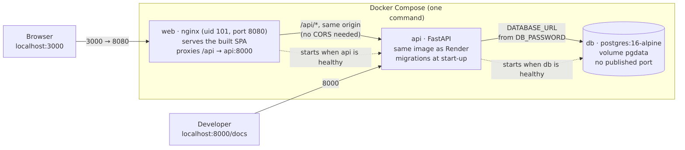

# 2. System architecture

*Draft for report section 2 (owner: Hoàng Minh). Sources: [ARCHITECTURE.md §1–5](../ARCHITECTURE.md),
[`docs/diagrams/`](../diagrams/README.md), the code in `app/`. The production diagram was checked
against the live services on 22/10/2026.*

Fair-Share is a three-tier web application: a React single-page app (presentation), a FastAPI service
in a Docker container (application) and a managed PostgreSQL database (data). One AI call, Quick add,
goes from our server to Google Gemini. Every piece runs on a free tier that needs no credit card.

## 2.1 What runs where


| Component | Platform | Talks to | Configured by |
|---|---|---|---|
| **Web app**: React + TypeScript SPA | Render Static Site `fair-share-web` (CDN, HTTPS, never sleeps) | The API, over HTTPS (`fetch`) | `VITE_API_BASE_URL` at build time (public); rewrite `/* → /index.html` |
| **API**: FastAPI + Uvicorn | Render Web Service `fair-share-4bu9`, our Docker image, non-root | Supabase, Gemini | `DATABASE_URL`, `GEMINI_API_KEY`, `ALLOWED_ORIGINS`, … (Render environment) |
| **Database**: PostgreSQL | Supabase, reached through the session pooler over TLS | — | One `DATABASE_URL` on the API |
| **AI**: Gemini `gemini-3.5-flash-lite` | Google AI Studio free tier | — | `GEMINI_API_KEY`, only on the API |
| **CI/CD** | GitHub Actions | Render deploy hooks | Hooks in Actions secrets; Render auto-deploy off |

Cloudflare sits in front of both Render services: it terminates HTTPS and appends the visitor's address
to `X-Forwarded-For` (headers `Server: cloudflare` and `CF-RAY` on every live response).

**Why the browser never talks to the database or to Gemini.** The connection string and the AI key exist
only as environment variables of the API service. The web app is static files, and anything shipped to a
browser is public, so it only ever calls our own API.

## 2.2 How the parts communicate

| From → to | Protocol and format | Security |
|---|---|---|
| Browser → web app | HTTPS, HTML/JS/CSS | Cloudflare/Render certificates |
| Browser → API | HTTPS, JSON under `/api/*` | **CORS** allows only the web app's origin: a preflight from another origin is refused (checked live) |
| API → database | PostgreSQL protocol over TLS (`sslmode=require`), parameterised SQL only | Credentials only in `DATABASE_URL`; Row Level Security on every table closes Supabase's public REST API |
| API → Gemini | HTTPS `generateContent`, JSON schema for the answer | Key in the `x-goog-api-key` header, never in a URL or a log |
| GitHub → Render | HTTPS deploy hook, pinned to the tested commit | Hook URLs in Actions secrets |

**One request end to end: adding an expense.** The page posts the form to
`POST /api/households/7/expenses`. FastAPI validates the body before anything else (lengths, a whole
positive amount in đồng, dates, members of this household; otherwise `422` naming the field). The route
takes a connection from the pool, computes the shares (the equal split gives leftover đồng to the lowest
member ids, so shares always add up), inserts the expense and its shares **in one transaction**, and the
transaction is **committed before the response is sent**. Only then does the page get `201` and the saved
expense. Balances are never stored: the dashboard's `GET /balances` computes them from expenses and
settlements on every request, so an edit shows immediately.

## 2.3 Inside the API

```
app/
├── main.py          create_app(): middleware, error handlers, routers, start-up and shut-down
├── config.py        all settings from environment variables, in one place
├── db.py            the connection pool and the one-transaction-per-request dependency
├── migrate.py       applies db/migrations/*.sql at start-up (section 5)
├── errors.py        one error format for everything: {"error": {"code", "message"}}
├── schemas.py       request/response models; limits equal the database's CHECK constraints
├── limits.py        refuses request bodies over 64 KB (413)
├── routers/         system, households, members, expenses, settlements, balances, ai
└── services/        logic without a database, unit-tested: splitting, balances, names,
                     rate_limit, gemini (the only file that calls Gemini)
```

- **Stateless for the data.** All user data is in PostgreSQL; the API keeps none on its own disk. A
  restart, a redeploy or a second instance changes nothing for the data (section 5). Only short-lived
  counters live in memory: the AI request limits and the 20 s database back-off (#127). They are per
  instance, so with two instances each would allow its own 5/min; that is fine for our single free
  instance, and a restart only resets them.
- **Routers are thin, services are pure.** The money logic (equal split, net balances, the greedy
  settlement plan with at most *n − 1* transfers) lives in `services/` as plain functions, tested with
  property tests over thousands of random households. The routers only validate, run SQL and call them.
- **One error format.** Every failure, our own or the framework's (unknown route, wrong method, body too
  large, database down), answers `{"error": {"code", "message"}}`. `code` is stable for the page to branch
  on; `message` is safe to show; SQL errors and host names go only to the server log.
- **The AI call is fenced.** Quick add returns a *draft* and saves nothing. Names are matched to real
  members, the answer is treated as untrusted data, a per-visitor limit (5/min) and a global budget
  (10/min, 200/day) protect the free quota, and every failure leaves the manual form open.

## 2.4 Local versus production



`docker compose up --build` starts the same API image next to a `postgres:16-alpine` container and an
nginx container that serves the built SPA and proxies `/api` (so locally there is one origin and no CORS).
Section 3 explains the images and Compose; the point here is that **the API image is identical** in both
places, so what passes on a laptop and in CI is what Render runs.

## 2.5 How we know the diagram is true

The rule in our ARCHITECTURE.md is that the diagram must match what is deployed. On 22/10 each box and
arrow was checked against the live services ([table](../diagrams/README.md#checked-against-what-is-deployed-22102026)):
the API answered `/api/version` with `env: production` and the latest merged commit, the web app served a
deep link (so the rewrite rule exists), CORS accepted the web origin and refused another, and the
Cloudflare headers were present on both services. After every deploy the pipeline itself re-checks the
first point: the `smoke` job waits until the live commit equals the merged one, and an end-to-end browser
test runs the main flow on the live site.

## 2.6 Problems we met and how we fixed them

| Problem | Fix |
|---|---|
| Right after creating a member, renaming it sometimes answered 404: the database commit ran **after** the response had been sent (FastAPI's default scope for a dependency with `yield`). Found by Duy Anh in review | The connection dependency now uses `scope="function"`, so the commit happens before the response; a test breaks a constraint checked only at COMMIT and expects an error, not 200 (#84) |
| The AI per-visitor limit counted a proxy instead of the visitor: on Render, Cloudflare and two more proxies each append an `X-Forwarded-For` entry | The visitor is the entry `FORWARDED_HOPS` from the end (3 on Render, 1 behind nginx), confirmed from the live logs (#96, #97) |
| The browser could not call the API from the static site's domain | A CORS allow-list with exactly the web origin (`ALLOWED_ORIGINS`), never `*` (#80) |
| Bad input reached PostgreSQL and became a 500 (a NUL byte, broken Unicode) | Validation before the database: one cleaned text type, strict numbers, a date range, a body size limit (#107) |
