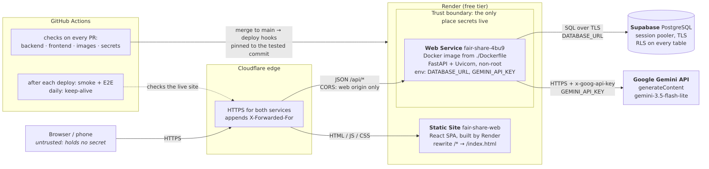

# 2. System architecture

*Owner: Hoàng Minh. Sources: [ARCHITECTURE.md §1–5](../ARCHITECTURE.md), [`docs/diagrams/`](../diagrams/README.md),
the code in `app/`; the diagram was checked against the live services on 22/10/2026.*

Fair-Share has three tiers: a React single-page app, a FastAPI service in a Docker container and a managed
PostgreSQL database. One AI call, Quick add, goes from our server to Google Gemini.

| Component | Runs on | Talks to, and how | Configured by |
|---|---|---|---|
| **Web app**, React + TypeScript | Render Static Site (CDN, never sleeps) | Only our API: HTTPS, JSON under `/api/*` | `VITE_API_BASE_URL` at build time (public) |
| **API**, FastAPI + Uvicorn | Render Web Service, our Docker image, non-root | PostgreSQL over TLS with parameterised SQL; Gemini over HTTPS with the key in a header | `DATABASE_URL`, `GEMINI_API_KEY`, `ALLOWED_ORIGINS` (Render environment) |
| **Database**, PostgreSQL | Supabase, through the session pooler | — | One `DATABASE_URL` |
| **CI/CD** | GitHub Actions | Render deploy hooks, pinned to the tested commit | Hooks in Actions secrets |

Cloudflare sits in front of both Render services. **CORS** lets only the web app's origin call the API (a
preflight from another origin is refused, checked live). The browser never talks to the database or to
Gemini: the connection string and the AI key exist only on the API, because anything shipped to a browser
is public. Row Level Security on every table closes Supabase's own public REST API.

**Accounts and private households** (#166, [ACCOUNTS.md](../ACCOUNTS.md)). People sign in with an email
and a password, stored as an argon2id hash; the API returns a random session token that the page sends as
`Authorization: Bearer`. A header and not a cookie, because the web app and the API are on two sites and
browsers block third-party cookies; not Supabase Auth, because Compose and CI run without Supabase.
Housemates join with an invite code and the owner approves them. A stranger, or someone still waiting,
gets the same `404` as for a household that does not exist, so ids cannot be probed; a member without the
right for an action gets `403`.

**One request end to end: adding an expense.** The page posts to `POST /api/households/7/expenses`.
FastAPI checks the session and the membership, then validates the body (lengths, a whole positive
amount in đồng, dates, members of this household; otherwise `422` naming the field). The route computes the shares (the equal
split gives the leftover đồng to the lowest member ids, so shares always add up), inserts the expense and
its shares **in one transaction**, and **commits before the response is sent**; only then does the page
get `201`. Balances are never stored: `GET /balances` computes them on every request, so an edit shows at
once.

**Inside the API.** Routers are thin: they validate, run SQL and call `services/`, where the money logic
(equal split, net balances, at most *n − 1* settlement transfers) is plain, property-tested functions. The
API keeps no data of its own, so a restart loses nothing; only the AI counters and a 20 s database back-off
live in memory. Every failure answers one format, `{"error": {"code", "message"}}`, with SQL and host names
only in the server log. Locally the **same image** runs in Compose (section 3).

| Problem we met | Fix |
|---|---|
| Renaming a member right after creating it sometimes gave 404: the commit ran **after** the response (FastAPI's default for a `yield` dependency). Found by Duy Anh in review | The dependency uses `scope="function"`, so the commit comes first; a test makes the commit fail and expects an error, not 200 (#84) |
| Bad input (a NUL byte, broken Unicode) reached PostgreSQL and became a 500 | One cleaned text type, strict numbers, a date range and a body size limit, all before the database (#107) |
| Anyone could open every group's households (peer review); then anyone with the key could change anything, even mark someone else's debt as paid (walkthrough as three users, 02/11) | Secret household keys, `+7` and `7.0` checked too (#132, #137, #138); then accounts with an owner and approval, and only the receiver of a repayment can record it (#166) |
