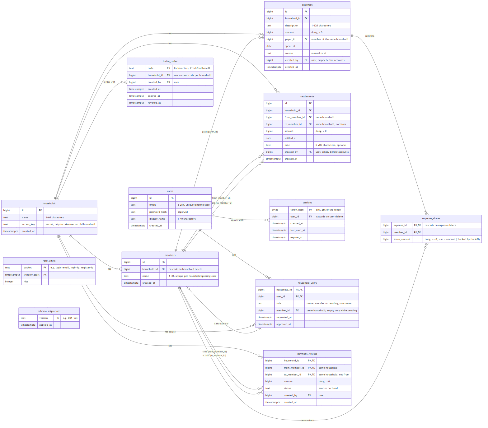

# 5. Database schema and integration

*Owner: Hoàng Minh. Sources: [`db/migrations/`](../../db/migrations/), [`app/migrate.py`](../../app/migrate.py),
[`app/db.py`](../../app/db.py), [PERSISTENCE_DRILL.md](../PERSISTENCE_DRILL.md), [OUTAGES.md](../OUTAGES.md).*

Production data lives in **Supabase PostgreSQL**, attached to the API by one environment variable,
`DATABASE_URL`. Locally, Compose runs `postgres:16-alpine`. Our own migrations create the schema in both,
so they reach the same state with no manual SQL.

A **household** has **members**; an **expense** is paid by one member and split into **expense_shares**; a
**settlement** records one member paying another back. `schema_migrations` records which migrations ran.

Accounts (`003_accounts.sql`) add five tables. A **user** signs in and opens **sessions**;
**household_users** says who is in which household, as owner, member or waiting for approval, and links
each approved person to one member name; **invite_codes** hold the codes for joining; **rate_limits**
count login, sign-up and code attempts. Expenses and settlements also remember which user recorded them
(`created_by`). `004_payment_notices.sql` adds **payment_notices**: "Tôi đã chuyển" from the person who
owes to the person they paid, which changes no balance until the receiver records it.

| Decision | Why |
|---|---|
| Money is whole đồng (`bigint`), never a float | Sums are exact and easy to test |
| The **API guarantees** shares add up to the amount | The database checks each share (`≥ 0`), the API the sum, in the same transaction. The equal split gives the leftover đồng to the lowest member ids (100 000 between three: 33 334 / 33 333 / 33 333); custom shares that do not add up get `422 split_mismatch` |
| Balances are **computed, not stored**: `net = paid − owed + sent − received` | Nothing to keep in sync; the nets of a household always sum to 0 (property-tested) |
| Payers and settlement sides must belong to the household | Composite foreign keys `(household_id, member_id)`: even a buggy request cannot mix two households |
| Member names unique per household, ignoring case; `CHECK` constraints mirror the API's limits | A unique index on `(household_id, lower(name))`. The API answers a clear 422 first; the database is the last line of defence |
| Row Level Security on every table, no policies | Closes the REST API Supabase publishes for `public` tables; our API owns the tables, which RLS does not restrict |
| A member used by an expense or settlement cannot be deleted | Foreign keys without `ON DELETE`: `409 member_in_use` instead of silently changed balances |
| A secret `access_key` per household (`002_household_keys.sql`, #132) | Ids are sequential; the database made 32 random hex characters per household. Since accounts it is used only to take over a household made before them |
| Passwords stored as argon2id hashes, session tokens only as SHA-256 | A copy of the tables cannot be used to sign in. Argon2 runs at OWASP's minimum (t=2, 19 MiB, 1 lane): with the library's defaults a login took about 4 s on a container limited like Render's free instance (found by Hoàng Minh in review) |
| One owner per household, one account per name, and a waiting person has no name | Partial unique indexes and `CHECK ((role = 'pending') = (member_id IS NULL))`; a composite foreign key keeps the name inside its household |
| Login, sign-up and code limits are counted in `rate_limits`, not in memory | A restart or a second instance does not reset them; an attempt is counted in one statement before the password is checked, so attempts at the same moment cannot slip past the limit |
| One "Tôi đã chuyển" notice per pair (`payment_notices`) | The primary key is the household and both names; it goes away with either name, and the receiver's "Đã nhận" records the repayment and removes it in one transaction |

**Migrations.** Numbered SQL files in `db/migrations/` are applied by the API **at start-up**: under a
PostgreSQL **advisory lock** (two instances cannot apply a file twice), each file not yet in
`schema_migrations` runs **in its own transaction** and is recorded; a failing file rolls back completely.
An unreachable database is logged and the API starts anyway, so `/health` stays green; an SQL error stops
it, so a broken deploy fails instead of half-applying a schema. Files are never edited; a change is a new
file (`002` added the household keys and gave every existing household one; `003` and `004` added the
account tables and left the old ones as they were). Tests cover a repeated run, a failing file and two
concurrent runs.

**How the API uses it.** Supabase's **session pooler** (IPv4) with `sslmode=require`; a `psycopg_pool` of
1–5 connections, each **tested before use** so dead ones are replaced after a restart or pause; one
transaction per request, committed before the response (section 2); parameterised SQL, no ORM. A database
that is down gives `503 database_unavailable`; `/health/db` runs one real query and reports the schema
version, while `/health` never touches the database.

**Restart, pause and restore**

| Event | What happens | Evidence |
|---|---|---|
| API restarted or redeployed | Nothing is lost: the API keeps no data | Drill: restarting and recreating the API container kept every row |
| Restore from our backup | `scripts/db-backup.sh` (pg_dump matched to the server) and `db-restore.sh` | Local drill, 22/10: wiped and restored, balances and expenses **byte-identical**, ids continued, no migration re-applied |
| Supabase pauses an idle project | The API answers `503`, `/health` stays up | Daily keep-alive query; resumed from the dashboard before a demo |
| Live API redeployed; production backup | A drill household fetched before and after each redeploy; the same scripts against Supabase, whose free plan keeps **no backups** of its own | Run 2: **byte-identical** after four redeploys (29/10–02/11), and restored from the backup into local PostgreSQL 16 |
| Accounts migration on real data | The 02/11 production backup restored into a separate Compose project, then `003_accounts` applied by the API at start-up | Row counts unchanged; household 72 taken over with its old key, and its balances byte-identical to the live site (#166) |

| Problem we met | Fix |
|---|---|
| Deleting a household with shared expenses failed: PostgreSQL checked the members' foreign keys before the nested cascade had run | Delete the expenses first, then the household, in one transaction; caught by a test (#83, #84) |
| On 22 and 23/10 `/health/db` answered 503 for about half an hour with no code change; the log showed the pooler unreachable, then **blocking our project** (`ECIRCUITBREAKER`) because our pool kept retrying | Back off: the pool stops retrying after 60 s and requests get the 503 at once for 20 s (#127). No data lost; the cause on Supabase's side is still open |

**How we know it works.** Over 430 backend tests run on every pull request against a real PostgreSQL 16: the
migration runner, the money and household rules written directly to the database, every endpoint, the
rights of each role checked one by one, and property tests of the money logic (2 000 random splits, 5 000 random balance sets). The broken split in draft PR #113 is
caught, and branch protection blocks it.
