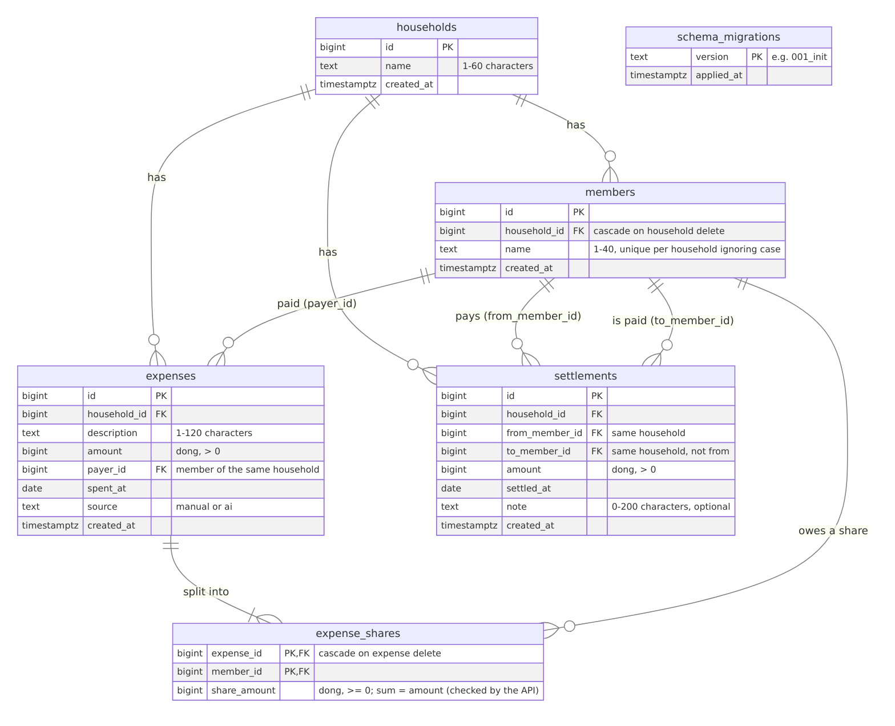

# 5. Database schema and integration

*Draft for report section 5 (owner: Hoàng Minh). Sources: [`db/migrations/001_init.sql`](../../db/migrations/001_init.sql),
[`app/migrate.py`](../../app/migrate.py), [`app/db.py`](../../app/db.py),
[ARCHITECTURE.md §4](../ARCHITECTURE.md#4-data-model), [PERSISTENCE_DRILL.md](../PERSISTENCE_DRILL.md).*

Production data lives in a managed **Supabase PostgreSQL** database, attached to the API by a single
environment variable, `DATABASE_URL`. Locally, Docker Compose runs `postgres:16-alpine` with the same
schema. The schema is created by our own migrations, so both reach the same state with no manual SQL.

## 5.1 The schema

Five tables: a **household** has **members**; an **expense** is paid by one member and split into
**expense_shares**, one per participant; a **settlement** records one member paying another back. A sixth
table, `schema_migrations`, records which migrations have run.

| Decision | Why |
|---|---|
| Money is a whole number of đồng (`bigint`), never a float | No rounding errors; sums are exact and easy to test |
| Shares are stored, and always add up to the expense amount | The equal split gives everyone `amount // n` and the leftover đồng to the lowest member ids (100 000 between three: 33 334 / 33 333 / 33 333) |
| Balances are **computed, not stored**: `net = paid − owed + sent − received` | Nothing to keep in sync: an edit or a delete changes the balances on the next request. The nets of a household always sum to 0 (property-tested) |
| A payer and both sides of a settlement must belong to the expense's household | Composite foreign keys `(household_id, member_id)`: even a buggy request cannot mix two households |
| Member names unique per household, ignoring case | A unique index on `(household_id, lower(name))`; the API also stores text in one Unicode form, so "Tiến" typed two different ways is still one member |
| `CHECK` constraints mirror the API's limits | Name lengths, `amount > 0`, `share_amount ≥ 0`, `from ≠ to`. The API validates first (a clear 422); the database is the last line of defence |
| Row Level Security enabled on every table, with no policies | Supabase also publishes `public` tables through a REST API with a public key; RLS closes it. Our API connects as the tables' owner, which RLS does not restrict |
| A member who appears in an expense or settlement cannot be deleted | Foreign keys without `ON DELETE`: the API answers `409 member_in_use` instead of silently changing balances |

## 5.2 Migrations: the same schema everywhere

Numbered SQL files in `db/migrations/` are applied by the API **at start-up** (`app/migrate.py`):

1. Take a PostgreSQL **advisory lock**, so two instances starting together cannot apply a file twice.
2. Read `schema_migrations`; for each file not yet recorded, run it **in its own transaction** and record
   it. A failing file rolls back completely and is not recorded.
3. If the database cannot be reached, log it and start anyway, so `/health` stays green (Render would
   otherwise restart the service in a loop); the next start applies the migrations. A migration with an
   SQL error, on the other hand, stops the API, so a broken deploy fails instead of half-applying a schema.

Applied files are never edited; a change is a new file. CI applies the migrations to a fresh PostgreSQL in
every pull request (`python -m app.migrate`), and the tests cover a repeated run, a failing file and two
concurrent runs.

## 5.3 How the API uses the database

| Aspect | What we do |
|---|---|
| Connection | One `DATABASE_URL`. In production: Supabase's **session pooler** (IPv4) with `sslmode=require`. Locally: built in `compose.yml` from `DB_PASSWORD` |
| Pool | `psycopg_pool`, 1 to 5 connections (well under the free tier's limit), 3 s to connect, at most 5 s waiting for a free connection. Each connection is **tested before use**, so after a database restart or pause dead connections are replaced instead of failing requests |
| Transactions | One per request, **committed before the response is sent**: a client that reads right after a write sees it, and a failed commit is an error, never a false "201" |
| SQL | Plain parameterised SQL with psycopg 3 (no ORM): no string-built queries, so no SQL injection |
| Errors | A database that is down or busy → `503 database_unavailable` with a safe message; details go to the server log. Constraint violations the API expects become clear codes (`409 member_name_taken`, `409 member_in_use`) |
| Readiness | `/health/db` runs one real query (`{"db":"ok","schema":"001_init"}`); `/health` never touches the database, so a paused database does not make Render restart a healthy API |

## 5.4 Restart and pause

| Event | What happens | Evidence |
|---|---|---|
| The API restarts or is redeployed | Nothing is lost: the API is stateless; the pool reconnects at start-up | Drill: restarting and recreating the API container kept every row ([PERSISTENCE_DRILL.md](../PERSISTENCE_DRILL.md)) |
| The database is restored from our backup | `scripts/db-backup.sh` (pg_dump, matched to the server's version) and `scripts/db-restore.sh` | Local drill on 22/10: wiped and restored, balances and expenses **byte-identical**, next id continued correctly, no migration re-applied |
| Supabase pauses an idle free project | The API answers `503` with a clear message instead of crashing; `/health` stays up | A daily keep-alive workflow runs a real query so the project is not paused; before a demo it is resumed from the dashboard |
| Production backup and Render restart | Same scripts against the Supabase URL; *Restart service* on Render, data compared before/after | *To fill in from run 2 of the drill* |

## 5.5 Problems we met and how we fixed them

| Problem | Fix |
|---|---|
| Deleting a household that had shared expenses failed: PostgreSQL checked the members' foreign keys before the nested cascade (expenses → shares) had run | The API deletes the household's expenses first, then the household, in one transaction; found by a test before any user hit it (#83, #84) |
| The commit ran after the response (see section 2.6) | Commit before the response (#84) |
| A NUL byte or broken Unicode in a name reached PostgreSQL, which refuses both: a 500 | Text is cleaned and checked before the database; a decomposed "Tiến" no longer creates a second identical member (#107) |
| The first restore stopped at `schema "public" already exists` | The restore script leaves out exactly that line of the dump; any other error still stops it |
| On 22/10 the live database check answered 503 (pool timeout) with no code change, and recovered about half an hour later | The cause is in the Render log; it is why we keep our own backups and a keep-alive rather than trusting the free tier |

## 5.6 How we know it works

- **282 backend tests** run on every pull request against a real PostgreSQL 16 service container in
  GitHub Actions; a pull request cannot merge unless they pass. They include the migration runner, every
  schema rule above (by writing directly to the database), every endpoint, and property tests of the money
  logic (2 000 random splits, 5 000 random balance sets).
- A deliberately broken split (draft PR #113, kept for the demo) is caught by 8 of those tests, and branch
  protection blocks the merge.
