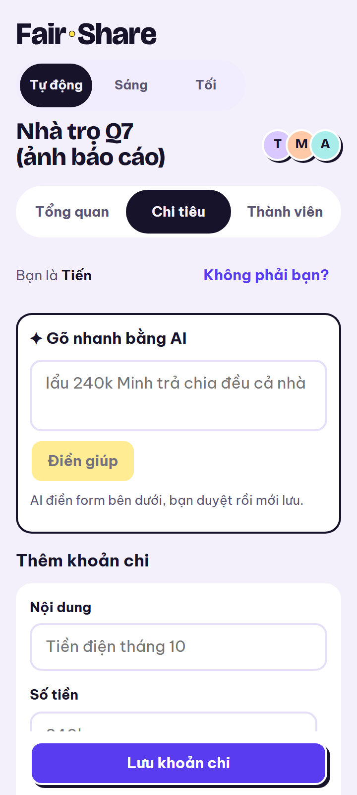
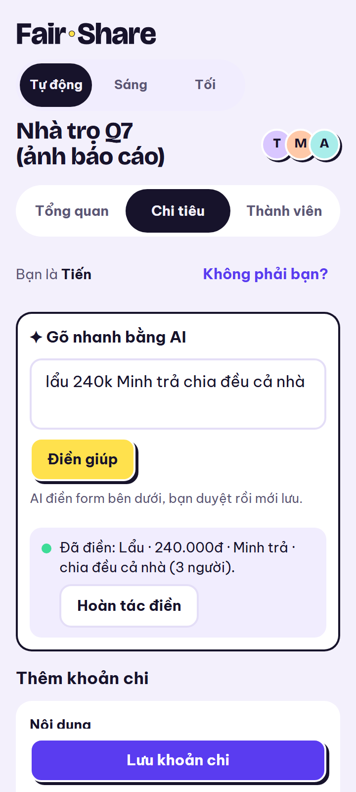
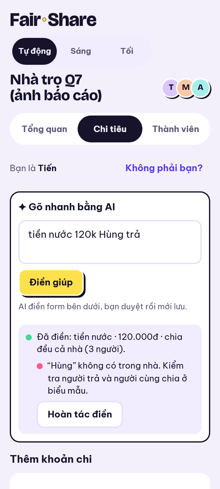
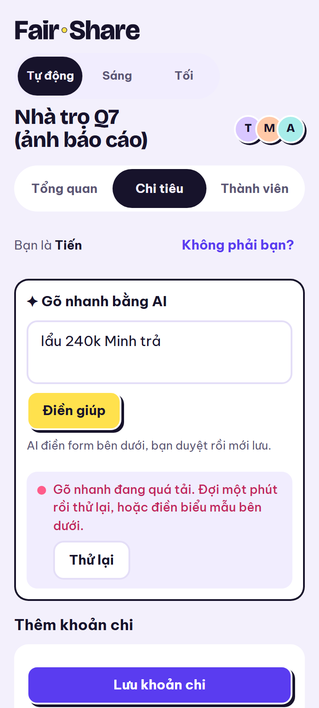
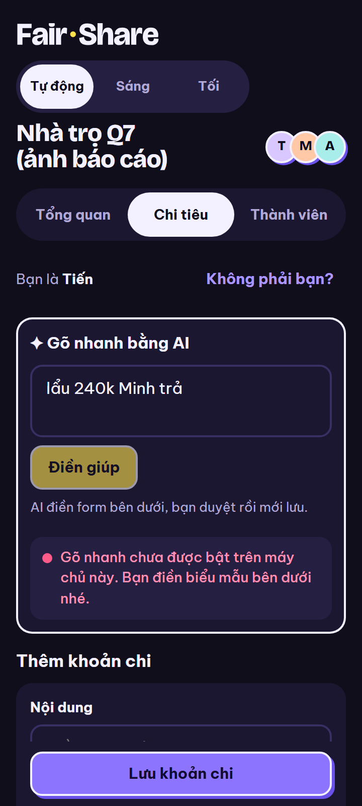

# 6. AI API integration: Quick add

*Draft for report section 6 (owners: Việt Tiến, screenshots Duy Anh). Sources:
[ARCHITECTURE.md §6](../ARCHITECTURE.md#6-ai-integration--quick-add), `app/services/gemini.py`,
`app/services/rate_limit.py`, `app/routers/ai.py`, [screenshots](img/README.md). Live measurements from
21–22/10/2026.*

Quick add turns one sentence, such as *"lẩu 240k Minh trả chia đều cả nhà"*, into a **pre-filled expense
form**. The AI never saves anything: it proposes a draft, the user checks it, and the normal form saves
it. That one rule shapes the whole integration: if the AI is slow, wrong, over quota or switched off,
the user still has the form and loses nothing they typed.

## 6.1 Where the call happens

The browser never talks to Gemini. It sends the sentence to our API, `POST
/api/households/{id}/ai/parse-expense`, and only the server calls Google:

1. **Check the request.** At most 300 characters, the household exists and has members, the visitor
   and the global budget still have room (6.3).
2. **Call Gemini** (`generateContent`, model `gemini-3.5-flash-lite`) from `app/services/gemini.py`, the
   only file that knows Gemini exists. The prompt carries the sentence, the household members' names as
   they were entered and today's date, and asks for an answer in a **JSON schema** (description,
   amount, payer, participants, date).
3. **Treat the answer as untrusted data.** It is validated against the schema; amounts must be positive
   whole đồng; names are matched to the real members ignoring case and accents (`"tien"` → Tiến), and a
   name that is not a member becomes a **warning**, never a new person.
4. **Return a draft**, in exactly the shape of the normal expense body, plus warnings for the form to
   show: `unknown_member`, `no_payer`, `no_amount`, `participants_assumed`.

Because the draft has the same shape as a manual expense, saving it is the ordinary `POST /expenses`
with `source: "ai"`, and the list marks it with a ✦ AI chip.

|  |  |  |
|---|---|---|
| Idle: "AI fills the form below, you check it before saving" | Filled from a real Gemini answer: Lẩu · 240.000đ · Minh trả · split between 3 | "Hùng" is not a member: the payer is left empty, with a note to check it |

## 6.2 The key

`GEMINI_API_KEY` exists in one place: an environment variable of the Render API service. It is read at
start-up by `app/config.py`, sent to Google in the `x-goog-api-key` **header** (never in a URL, which
could end up in a log), and never logged, returned or sent to the browser. CI never has it: the tests
replace Gemini with a fake, so 290 backend tests run without a key and without spending quota. A server
without a key answers `503 ai_not_configured`, and the page turns Quick add off and points to the form.

## 6.3 Limits and the 429 behaviour

Gemini's free quota is per Google project, per minute and per day. Our server enforces two limits below
it, in `app/services/rate_limit.py`, before any call is made:

| Limit | Value | Why |
|---|---|---|
| Per visitor | 5 requests per minute | One person cannot use up everyone's quota |
| Global budget | 10 per minute, 200 per day | Stays under the project's free quota, so Google never has to refuse us |
| Sentence length | 300 characters | Bounds the tokens of each call |

*Gemini's own free-tier numbers for `gemini-3.5-flash-lite` (requests per minute, per day, tokens per
minute), as shown in Google AI Studio on [date]: [to fill in].*

**Who is one visitor** was the hardest part. Behind Render, each proxy appends an address to
`X-Forwarded-For`, so the first versions counted a proxy instead of the visitor and let every request
through. The live logs showed three entries, with the visitor's address third from the end (Cloudflare's
`CF-Connecting-IP` confirms it), so the API reads that one (`FORWARDED_HOPS=3`); anything further left,
which a client could forge, is ignored. Tested from a phone on the live site on 21/10: the first
requests got `200`, and once five had been made within a minute the next one got `429`.

**What the user sees for each failure.** We do not retry automatically on `429` or after a timeout: it
would burn quota and make the user wait. Only a *fast* `5xx` from Gemini is retried once, and only if the
global budget has room.

| Code | When | What the page does |
|---|---|---|
| `429 ai_rate_limited` | Our limit or Google's quota | "Busy, wait a minute", **Thử lại**; the sentence and the form stay |
| `503 ai_unavailable` | Gemini down, too slow (20 s) or a failed retry | Same, the form stays usable |
| `422 ai_unparseable` | No usable answer | Fix the sentence or fill in the form |
| `503 ai_not_configured` | No key on this server | Quick add disabled, no *Thử lại* |

|  |  |
|---|---|
| 429: the sentence is kept and the form works at once | No key (dark mode): Quick add is off, the form is the way |

*Screenshots 5 and 6 show the real page with the API's error answer simulated in the browser: Gemini
cannot be made busy, nor its key removed, on demand on the live site. Screenshots 1–4 are real.*

## 6.4 Latency

Every call logs how long Gemini took. On 21/10 the live server measured **7.2 to 8.8 s** per answer, and
most early failures were our first 10 s timeout cutting off answers still on their way, so the timeout
became 20 s. While it waits the page shows a progress bar with the seconds and a **Nhập tay** link that
stops waiting and moves to the form; an answer arriving after that, or after the expense was saved, is
dropped instead of overwriting the form. Fields the user typed while waiting are never overwritten by the
draft, and **Hoàn tác điền** undoes the fill.

## 6.5 Data sent to Google

Only the sentence, the household members' names and today's date: no amounts already stored, no other
households, no database ids. We treat the answer as untrusted rather than trying to make the prompt
injection-proof: a sentence such as "ignore the rules" can at worst produce a wrong draft, which still
has to pass the schema and the member matching above, is shown to the user, and is written only when
the user presses *Lưu khoản chi*.
